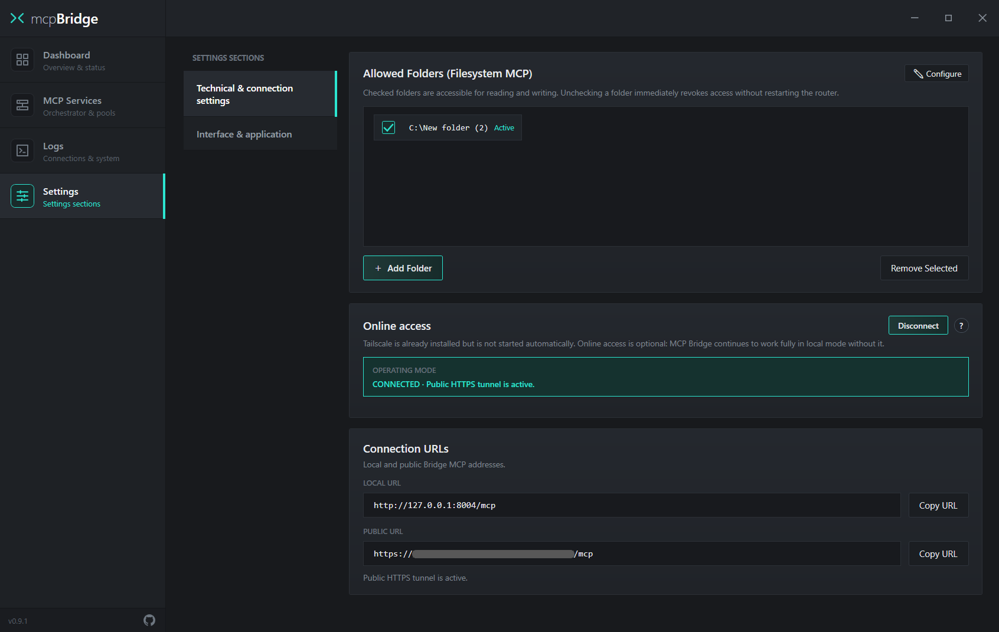
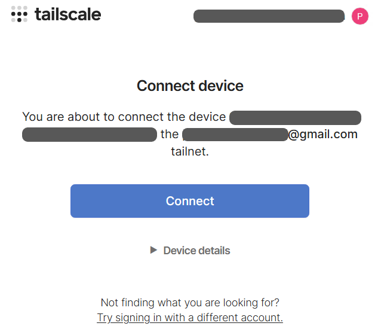
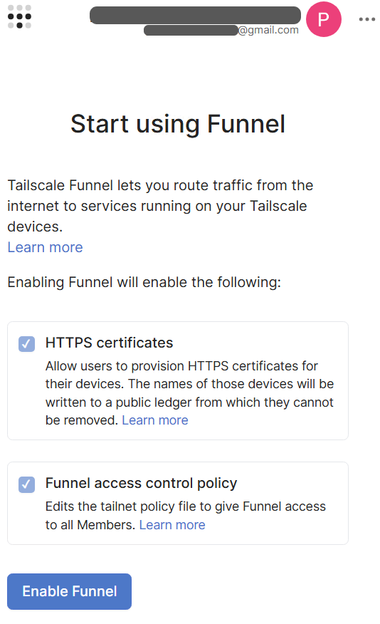
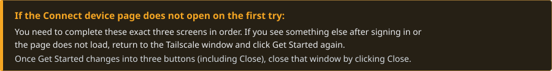
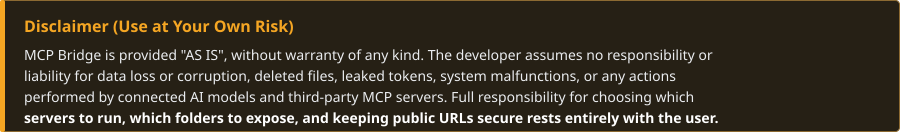

  &nbsp;&nbsp;

  
  <h1>mcp<b>Bridge</b></h1>
  

    <b>Unified Local Hub & MCP Server Manager for Windows</b> 
    Connect Bridge to your AI client once and control all your servers and tools from a single window.
  

  

    
  

  

    &nbsp;
    &nbsp;
    &nbsp;
    &nbsp;
    &nbsp;
    &nbsp;
    
  

 

<!-- ===================================================================== -->
<!-- 01. WHY MCP BRIDGE                                                    -->
<!-- ===================================================================== -->

<table>
  <thead>
    <tr>
      <th width="500" align="left">Clean AI Context &amp; Real-Time Switching</th>
      <th width="500" align="left">Single Connection &amp; 1-Click Presets</th>
    </tr>
  </thead>
  <tbody>
    <tr>
      <td width="500" valign="top">
        

          
Connecting many MCP servers (for example, 50–150 tools) can clutter the available tool list and increase context usage. With Bridge, you can enable only the servers you need <b>right in the middle of a conversation</b> — without restarting the chat or refreshing the page.

           
          Instead of registering dozens of individual JSON tool schemas as tools in the external MCP connection, the gateway permanently exposes only 2 lightweight meta-tools: <code>all_tools</code> and <code>call_tool</code>. When it needs to find a capability, the model can request the current catalogue through <code>all_tools</code>, choose the relevant tool itself, and invoke it through <code>call_tool</code>. This can reduce the amount of tool-definition data supplied up front, helping lower token usage and context overhead — especially when many servers are connected — while reducing reliance on client-side <code>tools/list</code> refresh behavior. Catalogue revisions (<code>catalog_revision</code>) help the model identify an updated snapshot when it requests the catalogue again.
        

      </td>
      <td width="500" valign="top">
        

          
Stop manually editing JSON configs across every separate AI client. Connect the Bridge endpoint once, and add, configure, or toggle all your servers inside a single window.

           
          Group servers into task-specific <b>Server Presets</b> and switch workflows in 1 click without dropping active sessions. When adding a new server, smart clipboard import automatically parses <code>mcpServers</code> JSON blocks, CLI commands, or URLs.
        

      </td>
    </tr>
  </tbody>
  <thead>
    <tr>
      <th width="500" align="left">Local STDIO Servers in Web AI Apps</th>
      <th width="500" align="left">Managed Server Process &amp; RAM Control</th>
    </tr>
  </thead>
  <tbody>
    <tr>
      <td width="500" valign="top">
        

          
Most MCP servers only run locally via CLI (<code>npx</code>, <code>uvx</code>, <code>python</code>), while web AI services require a public <code>HTTPS</code> URL. Bridge turns any local server into a secure HTTPS link in one click.

           
          Built-in <code>Supergateway</code> and <b>Tailscale Funnel</b> expose local STDIO servers over <code>Streamable HTTP</code> without router port forwarding and without modifying Windows DNS settings (<code>accept-dns=false</code>). Pre-existing Tailscale installations and preferences are preserved untouched.
        

      </td>
      <td width="500" valign="top">
        

          
Native <b>Windows WPF app</b> with system-tray support. When you disable a server, Bridge stops its managed process tree so it does not keep running in the background and consuming memory.

           
          Managed child processes are assigned to a <b>Windows Job Object</b> (<code>JOB_OBJECT_LIMIT_KILL_ON_JOB_CLOSE</code>). Additional descendant cleanup (<code>Toolhelp</code>) and startup WMI/TCP checks help terminate Bridge-managed process trees and prevent orphaned <code>node.exe</code> or <code>python.exe</code> processes.
        

      </td>
    </tr>
  </tbody>
  <thead>
    <tr>
      <th width="500" align="left">Verification Sandbox, Quarantine &amp; Auto-Wait</th>
      <th width="500" align="left">Live Folder Security &amp; Everything Included</th>
    </tr>
  </thead>
  <tbody>
    <tr>
      <td width="500" valign="top">
        

          
A failure or configuration issue in one server should not bring down the entire gateway. Failing services are isolated in <code>QUARANTINE</code>, while local plugins can wait for their target application to launch.

           
          New servers pass through a 4-stage verification pipeline (<code>Pre-flight</code> → <code>Transport</code> → <code>Initialize</code> → <code>Tools</code>). Lightweight socket hooks automatically detect whether a STDIO server connects to a local application port (e.g., a 3D editor, IDE, or local DB) or a remote API, keeping the server in <code>WAITING</code> while the target app is closed.
        

      </td>
      <td width="500" valign="top">
        

          
Grant or revoke AI folder access on the fly using simple checkboxes. <code>Node.js</code>, <code>uv</code>, <code>Filesystem MCP</code>, and <code>Tailscale</code> come pre-bundled in the installer — no manual setup required.

           
          The internal <code>roots-filter</code> strips client-supplied <code>roots</code> capabilities on <code>initialize</code> so remote clients cannot override your local folder allow-list. Remote servers require explicit per-origin HTTPS trust approval, and API keys or Bearer tokens are automatically redacted (<code>[REDACTED]</code>) in logs.
        

      </td>
    </tr>
  </tbody>
</table>

 

 

<!-- ===================================================================== -->
<!-- 02. INITIAL SETUP & CONNECTION                                        -->
<!-- ===================================================================== -->

Open the <b>Settings</b> tab — here you configure folder access, the public tunnel, and copy the connection URLs for your AI client:

<table>
  <thead>
    <tr>
      <th width="333" align="left">1. Allowed Folders</th>
      <th width="333" align="left">2. Online access</th>
      <th width="334" align="left">3. Connection URLs</th>
    </tr>
  </thead>
  <tbody>
    <tr>
      <td width="333" valign="top">
        Directories accessible to the built-in <b>Filesystem MCP</b>. Uncheck any folder to revoke AI access immediately without restarting the gateway.
      </td>
      <td width="333" valign="top">
        Enables the public HTTPS tunnel via <b>Tailscale Funnel</b>. Required only for web-based AI apps. Local desktop clients on your PC work without it.
      </td>
      <td width="334" valign="top">
        Ready-to-use gateway endpoints. Click <b>Copy URL</b> next to the address you need and paste it into your AI client settings.
      </td>
    </tr>
  </tbody>
</table>

<table>
  <thead>
    <tr>
      <th width="500" align="left">LOCAL URL — <code>http://127.0.0.1:8004/mcp</code></th>
      <th width="500" align="left">PUBLIC URL — <code>https://&lt;device&gt;.&lt;tailnet&gt;.ts.net/mcp</code></th>
    </tr>
  </thead>
  <tbody>
    <tr>
      <td width="500" valign="top">
        For applications installed on your PC (IDEs, desktop AI clients, local agents). Add a <code>Streamable HTTP</code> connection in your app's MCP settings and paste this URL.
      </td>
      <td width="500" valign="top">
        For web AI applications that support MCP. Depending on the service, this section may be called <i>connectors, plugins, integrations</i>, or connected via third-party extensions — simply paste the copied URL there.
      </td>
    </tr>
  </tbody>
</table>

 

<!-- ===================================================================== -->
<!-- 03. TAILSCALE AUTHORIZATION                                           -->
<!-- ===================================================================== -->

When clicking <b>Connect</b> under <i>Online access</i> for the first time, complete these three screens in order:

<table>
  <thead>
    <tr>
      <th width="333" align="left">STEP 1 · Welcome to Tailscale</th>
      <th width="333" align="left">STEP 2 · Sign In & Connect</th>
      <th width="334" align="left">STEP 3 · Start using Funnel</th>
    </tr>
  </thead>
  <tbody>
    <tr>
      <td width="333" valign="top">
          
        The Tailscale application window will open. Click <b>Get Started</b>.
      </td>
      <td width="333" valign="top">
          
        A login page will open in your browser — <b>sign in to your account</b>, then click <b>Connect</b> on the <i>Connect device</i> screen.
      </td>
      <td width="334" valign="top">
          
        The <b>Start using Funnel</b> page will open automatically. Scroll down, click <b>Enable Funnel</b>, and wait for the connection to finish.
      </td>
    </tr>
  </tbody>
</table>

 

<!-- ===================================================================== -->
<!-- 04. MAIN SCREEN (DASHBOARD)                                           -->
<!-- ===================================================================== -->

The <b>Dashboard</b> tab shows the gateway overview and currently enabled servers. Disabled servers (<code>DISABLED</code>) are hidden from the <i>MCP Services Status</i> table to keep it clean — they are visible in the <i>MCP Services</i> tab.

<table>
  <thead>
    <tr>
      <th width="250" align="left"></th>
      <th width="250" align="left"></th>
      <th width="250" align="left"></th>
      <th width="250" align="left"></th>
    </tr>
  </thead>
  <tbody>
    <tr>
      <td width="250" valign="top">The server is connected, verified, and exposing its tools to the chat.</td>
      <td width="250" valign="top">Waiting for a local application or endpoint to become available (e.g., an IDE, 3D editor, or local service).</td>
      <td width="250" valign="top">Startup or MCP protocol error. The server is isolated so other services keep working.</td>
      <td width="250" valign="top">Manually disabled by the user (shown only in the <i>MCP Services</i> tab).</td>
    </tr>
  </tbody>
</table>

 

<!-- ===================================================================== -->
<!-- 05. MANAGING MCP SERVERS & PRESETS                                    -->
<!-- ===================================================================== -->

<table>
  <thead>
    <tr>
      <th width="1000" align="left">How Real-Time Server Switching Works</th>
    </tr>
  </thead>
  <tbody>
    <tr>
      <td width="1000">
        You can enable or disable any servers right during an active conversation with the AI. At any given moment, <b>only the tools belonging to currently enabled servers</b> are available in the dialogue. You <b>do not need to reload the browser page</b>, restart your local client, or manually refresh the tool list in your AI settings — the gateway updates the available tools automatically.
      </td>
    </tr>
  </tbody>
</table>

<table>
  <thead>
    <tr>
      <th width="333" align="left">Server Presets</th>
      <th width="333" align="left">Enable (ON) & Tools</th>
      <th width="334" align="left">Edit & Remove</th>
    </tr>
  </thead>
  <tbody>
    <tr>
      <td width="333" valign="top">
        Click <b>Save Preset</b> to save the currently enabled combination of servers. Switch between saved profiles in 1 click without interrupting your session.
      </td>
      <td width="333" valign="top">
        The <b>ON</b> checkbox makes a server available to the chat. When disabled, Bridge stops its managed process tree through Windows Job Objects, releasing the memory used by those processes. <code>Tools: N</code> shows the number of available tools.
      </td>
      <td width="334" valign="top">
        The <b>✎</b> button opens the JSON configuration editor for the selected server, and <b>✕</b> removes the server from the list.
      </td>
    </tr>
  </tbody>
</table>

<table>
  <thead>
    <tr>
      <th width="1000" align="left">Under the Hood: 2-Meta-Tool Architecture (<code>all_tools</code> &amp; <code>call_tool</code>)</th>
    </tr>
  </thead>
  <tbody>
    <tr>
      <td width="1000">
        <b>MCP Bridge</b> uses <b>Model-Directed Tool Discovery (MTD)</b>: a model-directed way to discover and invoke tools. The external gateway at <code>:8004/mcp</code> permanently exposes only 2 meta-tools: <code>all_tools</code> and <code>call_tool</code>. When the model needs a capability, it requests the catalogue through <code>all_tools</code>, selects the tool relevant to its current task, and invokes it through <code>call_tool</code>. The full current catalogue remains available on request, but server tools are not all registered upfront as separate tools in the external MCP connection. This is a different division of responsibility from semantic Smart Routing: a separate mechanism selects tools by semantic relevance, while with MTD the model explores the catalogue and chooses the tools it needs. This can reduce the amount of tool-definition data supplied up front, helping lower token usage and context overhead — especially when many servers are connected — while reducing reliance on how a client handles <code>notifications/tools/list_changed</code> and caches <code>tools/list</code>. <code>all_tools</code> reads the cached snapshot maintained by the internal Poll Manager, while <code>call_tool</code> validates arguments against the JSON Schema and dispatches the call to the target server.
      </td>
    </tr>
  </tbody>
</table>

 

<!-- ===================================================================== -->
<!-- 06. ADDING AN MCP SERVER                                              -->
<!-- ===================================================================== -->

Click <b>+ Add Server</b> in the <i>MCP Services</i> tab to add a new local or remote server:

<table>
  <thead>
    <tr>
      <th width="333" align="left">1. Paste JSON</th>
      <th width="333" align="left">2. Verify & Add</th>
      <th width="334" align="left">3. Save Without Check</th>
    </tr>
  </thead>
  <tbody>
    <tr>
      <td width="333" valign="top">
        Copy a standard <code>mcpServers</code> block from the server's documentation and click <b>Paste from Clipboard</b> (or edit the JSON manually).
      </td>
      <td width="333" valign="top">
        Click <b>Verify & Add</b> — Bridge will test the startup, discover its tools, and immediately attach the server to the gateway.
      </td>
      <td width="334" valign="top">
        If the server depends on an external app that is currently closed, click <b>Save Without Check</b> — it will be added in <code>WAITING</code> mode.
      </td>
    </tr>
  </tbody>
</table>

 

<!-- ===================================================================== -->
<!-- 07. SECURITY & USER RESPONSIBILITY                                    -->
<!-- ===================================================================== -->

<table>
  <thead>
    <tr>
      <th width="500" align="left">1. Full Access to Allowed Folders</th>
      <th width="500" align="left">2. Running Third-Party STDIO Processes</th>
    </tr>
  </thead>
  <tbody>
    <tr>
      <td width="500" valign="top">
        The built-in <code>Filesystem MCP</code> grants the AI permission to read, modify, and delete files inside checked directories in <b>Allowed Folders</b>. Never expose entire system drives (<code>C:\</code>) or folders containing passwords, wallets, or SSH keys.
      </td>
      <td width="500" valign="top">
        Any CLI server you add (<code>npx</code>, <code>uvx</code>, <code>python</code>, <code>node</code>, <code>.exe</code>) runs on your PC under your Windows user account. Only add servers and packages from sources you completely trust.
      </td>
    </tr>
  </tbody>
  <thead>
    <tr>
      <th width="500" align="left">3. Public Tailscale Funnel URL</th>
      <th width="500" align="left">4. Local Storage of Keys & Tokens</th>
    </tr>
  </thead>
  <tbody>
    <tr>
      <td width="500" valign="top">
        When the tunnel is enabled, your <code>PUBLIC URL</code> is reachable from the internet by anyone who knows the address. Never share this URL publicly or expose it in screenshots, and click <b>Disconnect</b> when you no longer need remote access.
      </td>
      <td width="500" valign="top">
        Configured environment variables (<code>env</code>) and HTTP authorization headers (<code>Authorization</code> / API keys) are stored locally in plain text inside <code>Config/settings.json</code>. Do not share this file with others.
      </td>
    </tr>
  </tbody>
</table>

 

  

  
    <b>System Requirements:</b> Windows 10 x64 (1903+) / Windows 11 x64 · .NET Framework 4.8 
    <a href="docs/ARCHITECTURE.md">Architecture</a> · <a href="SECURITY.md">Security</a> · <a href="THIRD_PARTY_NOTICES.md">Third-Party Notices</a>
  

