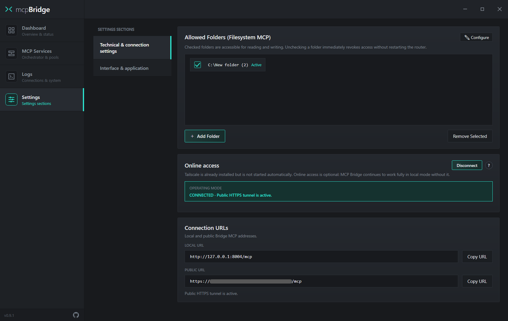
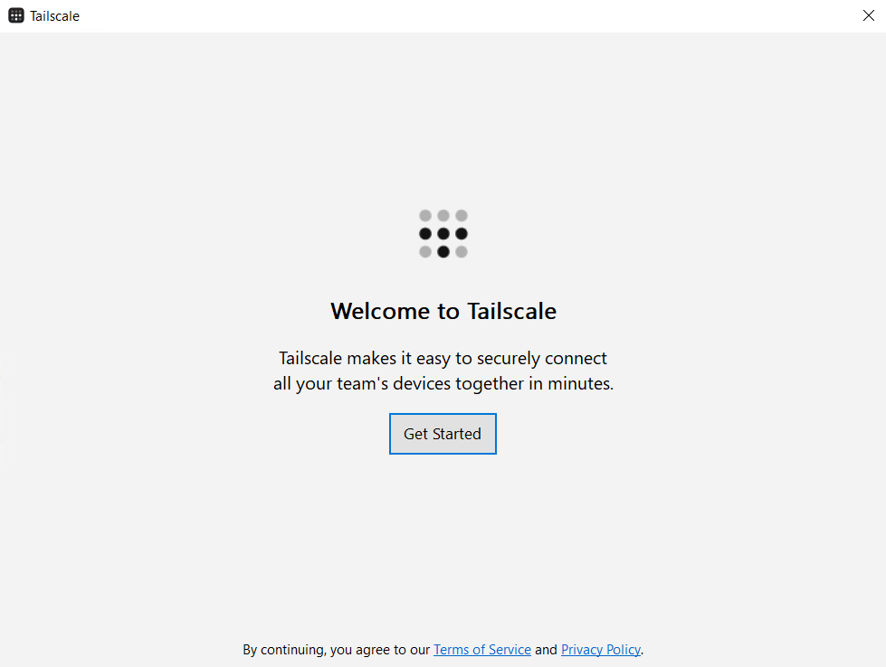
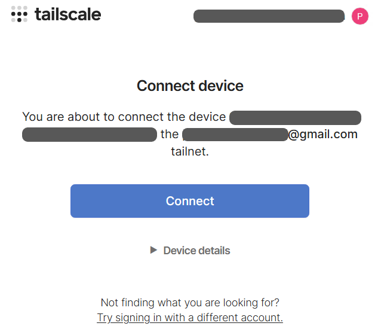
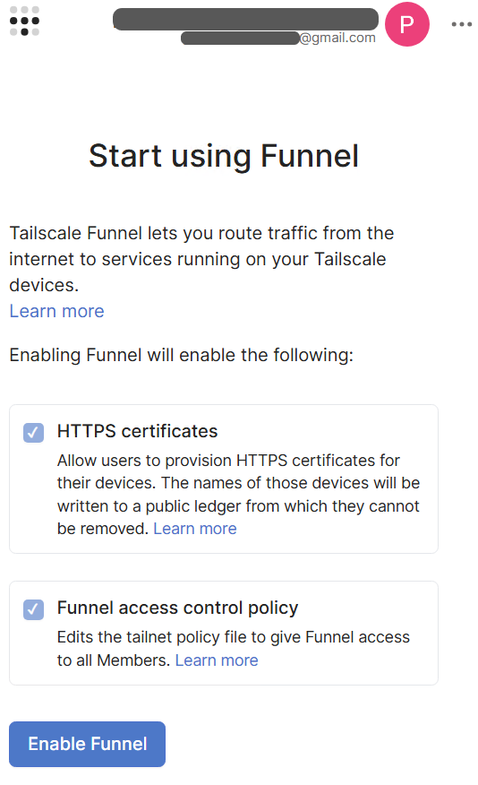
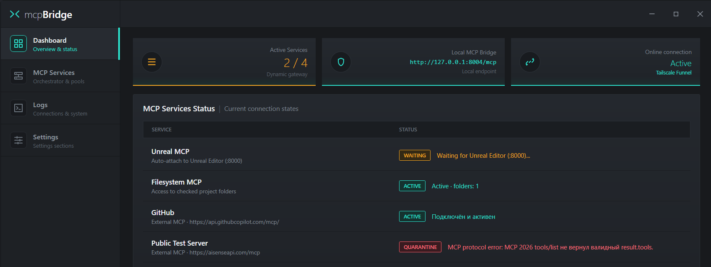
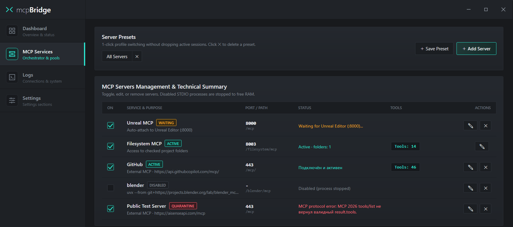
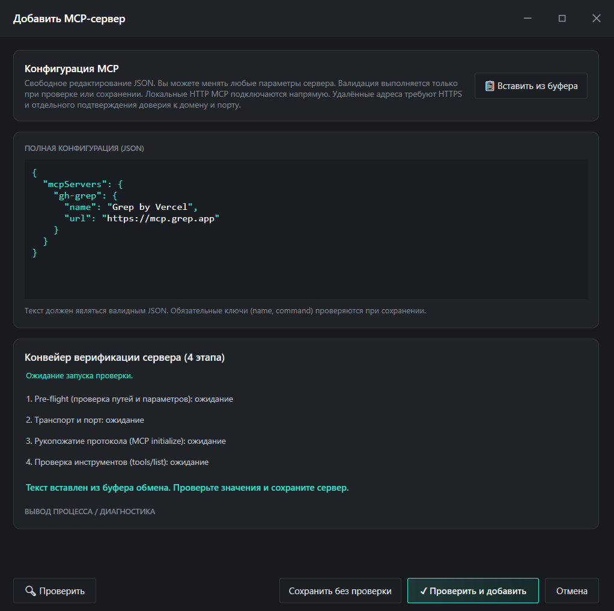

<!-- Floating Back-to-Top button in the bottom-right corner -->

  

<!-- Header: centered logo and language switcher on the same level -->
<table width="100%" style="display: table; width: 100%; table-layout: fixed; border-collapse: collapse; border: none; margin-top: 8px; margin-bottom: 12px;">
  <tr>
    <td width="25%" valign="top" style="border: none; background: transparent; padding: 0;"></td>
    <td width="50%" valign="top" align="center" style="border: none; background: transparent; padding: 0;">
      
      <h1 style="margin: 10px 0 6px 0; font-size: 36px; border: none; padding: 0;">mcp<b>Bridge</b></h1>
    </td>
    <td width="25%" valign="top" align="right" style="border: none; background: transparent; padding: 4px 0 0 0; white-space: nowrap;">
      &nbsp;&nbsp;
    </td>
  </tr>
</table>

  

    <b>Unified Local Hub & MCP Server Manager for Windows</b> 
    Connect Bridge to your AI client once and control all your servers and tools from a single window.
  

  

    
  

  

    &nbsp;
    &nbsp;
    &nbsp;
    &nbsp;
    &nbsp;
    &nbsp;
    
  

<!-- ===================================================================== -->
<!-- 01. WHY MCP BRIDGE                                                    -->
<!-- ===================================================================== -->

<table width="100%" style="display: table; width: 100%; table-layout: fixed; border-collapse: collapse; margin-top: 48px; margin-bottom: 22px;">
  <thead>
    <tr>
      <th align="left" style="background: linear-gradient(90deg, #1B3B38 0%, #162226 100%); border: 1px solid #2CE5D0; border-left: 6px solid #2CE5D0; border-radius: 4px; padding: 18px 24px; font-size: 21px; color: #FFFFFF; letter-spacing: 0.4px;">
        01 · WHY MCP BRIDGE
      </th>
    </tr>
  </thead>
</table>

<table width="100%" style="display: table; width: 100%; table-layout: fixed; border-collapse: collapse; border: none; margin-bottom: 0;">
  <tr>
    <td width="49%" valign="top" style="background: #141619; border: 1px solid #262A30; border-radius: 4px; padding: 22px 24px;">
      
Keep AI Context Clean

      

        Connecting a dozen servers (50–100 tools) at once confuses the model and wastes tokens. With Bridge, you enable only the servers you need <b style="color: #D6DCE2;">right in the middle of a conversation</b> — without restarting the chat.
      

    </td>
    <td width="2%" style="border: none; background: transparent; padding: 0;"></td>
    <td width="49%" valign="top" style="background: #141619; border: 1px solid #262A30; border-radius: 4px; padding: 22px 24px;">
      
One Connection Instead of Dozens

      

        Instead of manually editing JSON configs in every separate AI client, you connect the Bridge endpoint once and add, configure, or toggle all your servers inside a single window.
      

    </td>
  </tr>
  <tr style="height: 16px;">
    <td colspan="3" style="border: none; background: transparent; padding: 0;"></td>
  </tr>
  <tr>
    <td width="49%" valign="top" style="background: #141619; border: 1px solid #262A30; border-radius: 4px; padding: 22px 24px;">
      
Local STDIO Servers in Web AI Apps

      

        Most MCP servers only run locally via CLI (<code>npx</code>, <code>uvx</code>, <code>python</code>), while web AI services require a public <code>HTTPS</code> URL. Bridge turns any local server into a secure HTTPS link in one click.
      

    </td>
    <td width="2%" style="border: none; background: transparent; padding: 0;"></td>
    <td width="49%" valign="top" style="background: #141619; border: 1px solid #262A30; border-radius: 4px; padding: 22px 24px;">
      
RAM Control & Everything Included

      

        Disabled servers never linger as background processes — Bridge completely terminates them to free RAM. <code>Node.js</code>, <code>uv</code>, <code>Filesystem MCP</code>, and <code>Tailscale</code> are already bundled in the installer.
      

    </td>
  </tr>
</table>

<!-- ================= STANDALONE SUPPORT BLOCK ================= -->

<table width="100%" style="display: table; width: 100%; table-layout: fixed; border-collapse: collapse; background: linear-gradient(90deg, #282115 0%, #1C1A17 100%); border: 1px solid #8C6A32; border-left: 5px solid #F5A623; border-radius: 4px; margin: 64px 0;">
  <tr>
    <td width="70%" valign="middle" align="left" style="padding: 18px 24px; border: none; color: #EAECEF; font-size: 15px; line-height: 1.45;">
      This project is developed in spare time. If <b style="color: #F5A623;">MCP Bridge</b> makes your workflow easier — you can buy the author a coffee.
    </td>
    <td width="30%" valign="middle" align="right" style="padding: 18px 24px; border: none; line-height: 0;">
      
    </td>
  </tr>
</table>

<!-- ===================================================================== -->
<!-- 02. INITIAL SETUP & CONNECTION                                        -->
<!-- ===================================================================== -->

<table width="100%" style="display: table; width: 100%; table-layout: fixed; border-collapse: collapse; margin-top: 64px; margin-bottom: 22px;">
  <thead>
    <tr>
      <th align="left" style="background: linear-gradient(90deg, #1B3B38 0%, #162226 100%); border: 1px solid #2CE5D0; border-left: 6px solid #2CE5D0; border-radius: 4px; padding: 18px 24px; font-size: 21px; color: #FFFFFF; letter-spacing: 0.4px;">
        02 · INITIAL SETUP & CONNECTION
      </th>
    </tr>
  </thead>
</table>

Open the <b>Settings</b> tab — here you configure folder access, the public tunnel, and copy the connection URLs for your AI client:

  

<table width="100%" style="display: table; width: 100%; table-layout: fixed; border-collapse: collapse; border: none; margin-bottom: 16px;">
  <tr>
    <td width="32%" valign="top" style="background: #141619; border: 1px solid #262A30; border-radius: 4px; padding: 20px 22px;">
      
1. Allowed Folders

      

        Directories accessible to the built-in <b style="color: #D6DCE2;">Filesystem MCP</b>. Uncheck any folder to revoke AI access immediately without restarting the gateway.
      

    </td>
    <td width="2%" style="border: none; background: transparent; padding: 0;"></td>
    <td width="32%" valign="top" style="background: #141619; border: 1px solid #262A30; border-radius: 4px; padding: 20px 22px;">
      
2. Online access

      

        Enables the public HTTPS tunnel via <b style="color: #D6DCE2;">Tailscale Funnel</b>. Required only for web-based AI apps. Local desktop clients on your PC work without it.
      

    </td>
    <td width="2%" style="border: none; background: transparent; padding: 0;"></td>
    <td width="32%" valign="top" style="background: #141619; border: 1px solid #262A30; border-radius: 4px; padding: 20px 22px;">
      
3. Connection URLs

      

        Ready-to-use gateway endpoints. Click <b style="color: #D6DCE2;">Copy URL</b> next to the address you need and paste it into your AI client settings.
      

    </td>
  </tr>
</table>

<table width="100%" style="display: table; width: 100%; table-layout: fixed; border-collapse: collapse; border: none;">
  <tr>
    <td width="49%" valign="top" style="background: #141619; border: 1px solid #262A30; border-radius: 4px; padding: 20px 22px;">
      
LOCAL URL &nbsp;<code>http://127.0.0.1:8004/mcp</code>

      

        For applications installed on your PC (IDEs, desktop AI clients, local agents). Add a <code>Streamable HTTP</code> connection in your app's MCP settings and paste this URL.
      

    </td>
    <td width="2%" style="border: none; background: transparent; padding: 0;"></td>
    <td width="49%" valign="top" style="background: #141619; border: 1px solid #262A30; border-radius: 4px; padding: 20px 22px;">
      
PUBLIC URL &nbsp;<code>https://&lt;device&gt;.&lt;tailnet&gt;.ts.net/mcp</code>

      

        For web AI applications that support MCP. Depending on the service, this section may be called <i>connectors, plugins, integrations</i>, or connected via third-party extensions — simply paste the copied URL there.
      

    </td>
  </tr>
</table>

<!-- ===================================================================== -->
<!-- 03. TAILSCALE AUTHORIZATION                                           -->
<!-- ===================================================================== -->

<table width="100%" style="display: table; width: 100%; table-layout: fixed; border-collapse: collapse; margin-top: 88px; margin-bottom: 22px;">
  <thead>
    <tr>
      <th align="left" style="background: linear-gradient(90deg, #1B3B38 0%, #162226 100%); border: 1px solid #2CE5D0; border-left: 6px solid #2CE5D0; border-radius: 4px; padding: 18px 24px; font-size: 21px; color: #FFFFFF; letter-spacing: 0.4px;">
        03 · TAILSCALE AUTHORIZATION (FOR WEB APPS)
      </th>
    </tr>
  </thead>
</table>

When clicking <b>Connect</b> under <i>Online access</i> for the first time, complete these three screens in order:

<table width="100%" style="display: table; width: 100%; table-layout: fixed; border-collapse: collapse; border: none; margin-bottom: 16px;">
  <tr>
    <td width="32%" valign="top" style="background: #141619; border: 1px solid #262A30; border-radius: 4px; padding: 18px;">
      
STEP 1 · Welcome to Tailscale

      
      

        The Tailscale application window will open. Click <b style="color: #D6DCE2;">Get Started</b>.
      

    </td>
    <td width="2%" style="border: none; background: transparent; padding: 0;"></td>
    <td width="32%" valign="top" style="background: #141619; border: 1px solid #262A30; border-radius: 4px; padding: 18px;">
      
STEP 2 · Sign In & Connect

      
      

        A login page will open in your browser — <b style="color: #D6DCE2;">sign in to your account</b>, then click <b style="color: #D6DCE2;">Connect</b> on the <i>Connect device</i> screen.
      

    </td>
    <td width="2%" style="border: none; background: transparent; padding: 0;"></td>
    <td width="32%" valign="top" style="background: #141619; border: 1px solid #262A30; border-radius: 4px; padding: 18px;">
      
STEP 3 · Start using Funnel

      
      

        The <b style="color: #D6DCE2;">Start using Funnel</b> page will open automatically. Scroll down, click <b style="color: #D6DCE2;">Enable Funnel</b>, and wait for the connection to finish.
      

    </td>
  </tr>
</table>

<table width="100%" style="display: table; width: 100%; table-layout: fixed; border-collapse: collapse; background: #141619; border: 1px solid #262A30; border-left: 3px solid #F5A623; border-radius: 4px;">
  <tr>
    <td style="padding: 18px 22px; border: none; color: #969FA8; font-size: 14.5px; line-height: 1.55;">
      
If the Connect device page does not open on the first try:

      You need to complete these exact three screens in order. If you see something else after signing in or the page does not load, return to the Tailscale window and <b style="color: #D6DCE2;">click Get Started again</b>.  
      Once the <i>Get Started</i> button in the Tailscale window changes into three buttons (including device details and <b style="color: #D6DCE2;">Close</b>), close that window by clicking <b style="color: #D6DCE2;">Close</b> and wait for the <b style="color: #D6DCE2;">Start using Funnel</b> page to open.
    </td>
  </tr>
</table>

<!-- ===================================================================== -->
<!-- 04. MAIN SCREEN (DASHBOARD)                                           -->
<!-- ===================================================================== -->

<table width="100%" style="display: table; width: 100%; table-layout: fixed; border-collapse: collapse; margin-top: 88px; margin-bottom: 22px;">
  <thead>
    <tr>
      <th align="left" style="background: linear-gradient(90deg, #1B3B38 0%, #162226 100%); border: 1px solid #2CE5D0; border-left: 6px solid #2CE5D0; border-radius: 4px; padding: 18px 24px; font-size: 21px; color: #FFFFFF; letter-spacing: 0.4px;">
        04 · MAIN SCREEN (DASHBOARD)
      </th>
    </tr>
  </thead>
</table>

The <b>Dashboard</b> tab shows the gateway overview and currently enabled servers. Disabled servers (<code>DISABLED</code>) are hidden from the <i>MCP Services Status</i> table to keep it clean — they are visible in the <i>MCP Services</i> tab.

  

<table width="100%" style="display: table; width: 100%; table-layout: fixed; border-collapse: collapse; border: none;">
  <tr>
    <td width="23.5%" valign="top" style="background: #141619; border: 1px solid #262A30; border-radius: 4px; padding: 16px 18px;">
      
ACTIVE

      
The server is connected, verified, and exposing its tools to the chat.

    </td>
    <td width="2%" style="border: none; background: transparent; padding: 0;"></td>
    <td width="23.5%" valign="top" style="background: #141619; border: 1px solid #262A30; border-radius: 4px; padding: 16px 18px;">
      
WAITING

      
Waiting for an external application to start (e.g., Unreal Editor on port <code>:8000</code>).

    </td>
    <td width="2%" style="border: none; background: transparent; padding: 0;"></td>
    <td width="23.5%" valign="top" style="background: #141619; border: 1px solid #262A30; border-radius: 4px; padding: 16px 18px;">
      
QUARANTINE

      
Startup or MCP protocol error. The server is isolated so other services keep working.

    </td>
    <td width="2%" style="border: none; background: transparent; padding: 0;"></td>
    <td width="23.5%" valign="top" style="background: #141619; border: 1px solid #262A30; border-radius: 4px; padding: 16px 18px;">
      
DISABLED

      
Manually disabled by the user (shown only in the <i>MCP Services</i> tab).

    </td>
  </tr>
</table>

<!-- ===================================================================== -->
<!-- 05. MANAGING MCP SERVERS & PRESETS                                    -->
<!-- ===================================================================== -->

<table width="100%" style="display: table; width: 100%; table-layout: fixed; border-collapse: collapse; margin-top: 88px; margin-bottom: 22px;">
  <thead>
    <tr>
      <th align="left" style="background: linear-gradient(90deg, #1B3B38 0%, #162226 100%); border: 1px solid #2CE5D0; border-left: 6px solid #2CE5D0; border-radius: 4px; padding: 18px 24px; font-size: 21px; color: #FFFFFF; letter-spacing: 0.4px;">
        05 · MANAGING MCP SERVERS & PRESETS
      </th>
    </tr>
  </thead>
</table>

  

<table width="100%" style="display: table; width: 100%; table-layout: fixed; border-collapse: collapse; background: #141619; border: 1px solid #262A30; border-radius: 4px; margin-bottom: 16px;">
  <tr>
    <td style="padding: 20px 24px; border: none; color: #969FA8; font-size: 15px; line-height: 1.6;">
      
How Real-Time Server Switching Works

      You can enable or disable any servers right during an active conversation with the AI. At any given moment, <b style="color: #D6DCE2;">only the tools belonging to currently enabled servers</b> are available in the dialogue.  
      You <b style="color: #D6DCE2;">do not need to reload the browser page</b>, restart your local client, or manually refresh the tool list in your AI settings — the gateway updates the available tools automatically.
    </td>
  </tr>
</table>

<table width="100%" style="display: table; width: 100%; table-layout: fixed; border-collapse: collapse; border: none;">
  <tr>
    <td width="32%" valign="top" style="background: #141619; border: 1px solid #262A30; border-radius: 4px; padding: 20px 22px;">
      
Server Presets

      

        Check the combination of servers you need for a specific task and click <b style="color: #D6DCE2;">+ Save Preset</b>. Switch between saved profiles in 1 click without interrupting your session.
      

    </td>
    <td width="2%" style="border: none; background: transparent; padding: 0;"></td>
    <td width="32%" valign="top" style="background: #141619; border: 1px solid #262A30; border-radius: 4px; padding: 20px 22px;">
      
Enable (ON) & Tools

      

        The <b style="color: #D6DCE2;">ON</b> checkbox attaches a server to the chat on the fly or completely stops its process to free RAM, while <code>Tools: N</code> shows its active tool count.
      

    </td>
    <td width="2%" style="border: none; background: transparent; padding: 0;"></td>
    <td width="32%" valign="top" style="background: #141619; border: 1px solid #262A30; border-radius: 4px; padding: 20px 22px;">
      
Edit & Remove

      

        The <b style="color: #D6DCE2;">✎</b> button opens the JSON configuration editor for the selected server, and <b style="color: #D6DCE2;">✕</b> removes the server from the list.
      

    </td>
  </tr>
</table>

<!-- ===================================================================== -->
<!-- 06. ADDING AN MCP SERVER                                              -->
<!-- ===================================================================== -->

<table width="100%" style="display: table; width: 100%; table-layout: fixed; border-collapse: collapse; margin-top: 88px; margin-bottom: 22px;">
  <thead>
    <tr>
      <th align="left" style="background: linear-gradient(90deg, #1B3B38 0%, #162226 100%); border: 1px solid #2CE5D0; border-left: 6px solid #2CE5D0; border-radius: 4px; padding: 18px 24px; font-size: 21px; color: #FFFFFF; letter-spacing: 0.4px;">
        06 · ADDING AN MCP SERVER
      </th>
    </tr>
  </thead>
</table>

Click <b>+ Add Server</b> in the <i>MCP Services</i> tab to add a new local or remote server:

  

<table width="100%" style="display: table; width: 100%; table-layout: fixed; border-collapse: collapse; border: none;">
  <tr>
    <td width="32%" valign="top" style="background: #141619; border: 1px solid #262A30; border-radius: 4px; padding: 20px 22px;">
      
1. Paste JSON

      

        Copy a standard <code>mcpServers</code> block from the server's documentation and click <b style="color: #D6DCE2;">Paste from Clipboard</b> (or edit the JSON manually).
      

    </td>
    <td width="2%" style="border: none; background: transparent; padding: 0;"></td>
    <td width="32%" valign="top" style="background: #141619; border: 1px solid #262A30; border-radius: 4px; padding: 20px 22px;">
      
2. Verify & Add

      

        Click <b style="color: #D6DCE2;">Verify & Add</b> — Bridge will test the startup, discover its tools, and immediately attach the server to the gateway.
      

    </td>
    <td width="2%" style="border: none; background: transparent; padding: 0;"></td>
    <td width="32%" valign="top" style="background: #141619; border: 1px solid #262A30; border-radius: 4px; padding: 20px 22px;">
      
3. Save Without Check

      

        If the server depends on an external app that is currently closed, click <b style="color: #D6DCE2;">Save Without Check</b> — it will be added in <code>WAITING</code> mode.
      

    </td>
  </tr>
</table>

<!-- ===================================================================== -->
<!-- 07. SECURITY & USER RESPONSIBILITY                                    -->
<!-- ===================================================================== -->

<table width="100%" style="display: table; width: 100%; table-layout: fixed; border-collapse: collapse; margin-top: 88px; margin-bottom: 22px;">
  <thead>
    <tr>
      <th align="left" style="background: linear-gradient(90deg, #332915 0%, #1F1B16 100%); border: 1px solid #F5A623; border-left: 6px solid #F5A623; border-radius: 4px; padding: 18px 24px; font-size: 21px; color: #FFFFFF; letter-spacing: 0.4px;">
        07 · SECURITY & USER RESPONSIBILITY
      </th>
    </tr>
  </thead>
</table>

<table width="100%" style="display: table; width: 100%; table-layout: fixed; border-collapse: collapse; background: #262015; border: 1px solid #8C6A32; border-left: 5px solid #F5A623; border-radius: 4px; margin-bottom: 18px;">
  <tr>
    <td style="padding: 20px 24px; border: none; color: #EAECEF; font-size: 15px; line-height: 1.6;">
      
Disclaimer (Use at Your Own Risk)

      <b>MCP Bridge</b> is provided "AS IS", without warranty of any kind. The developer assumes no responsibility or liability for data loss or corruption, deleted files, leaked tokens, system malfunctions, or any actions performed by connected AI models and third-party MCP servers.  
      <b>Full responsibility for choosing which servers to run, which folders to expose, and keeping public URLs secure rests entirely with the user.</b>
    </td>
  </tr>
</table>

<table width="100%" style="display: table; width: 100%; table-layout: fixed; border-collapse: collapse; border: none;">
  <tr>
    <td width="49%" valign="top" style="background: #141619; border: 1px solid #8C6A32; border-radius: 4px; padding: 20px 22px;">
      
1. Full Access to Allowed Folders

      

        The built-in <code>Filesystem MCP</code> grants the AI permission to read, modify, and delete files inside checked directories in <b>Allowed Folders</b>. Never expose entire system drives (<code>C:\</code>) or folders containing passwords, wallets, or SSH keys.
      

    </td>
    <td width="2%" style="border: none; background: transparent; padding: 0;"></td>
    <td width="49%" valign="top" style="background: #141619; border: 1px solid #8C6A32; border-radius: 4px; padding: 20px 22px;">
      
2. Running Third-Party STDIO Processes

      

        Any CLI server you add (<code>npx</code>, <code>uvx</code>, <code>python</code>, <code>node</code>, <code>.exe</code>) runs on your PC under your Windows user account. Only add servers and packages from sources you completely trust.
      

    </td>
  </tr>
  <tr style="height: 16px;">
    <td colspan="3" style="border: none; background: transparent; padding: 0;"></td>
  </tr>
  <tr>
    <td width="49%" valign="top" style="background: #141619; border: 1px solid #8C6A32; border-radius: 4px; padding: 20px 22px;">
      
3. Public Tailscale Funnel URL

      

        When the tunnel is enabled, your <code>PUBLIC URL</code> is reachable from the internet by anyone who knows the address. Never share this URL publicly or expose it in screenshots, and click <b>Disconnect</b> when you no longer need remote access.
      

    </td>
    <td width="2%" style="border: none; background: transparent; padding: 0;"></td>
    <td width="49%" valign="top" style="background: #141619; border: 1px solid #8C6A32; border-radius: 4px; padding: 20px 22px;">
      
4. Local Storage of Keys & Tokens

      

        Configured environment variables (<code>env</code>) and HTTP authorization headers (<code>Authorization</code> / API keys) are stored locally in plain text inside <code>Config/settings.json</code>. Do not share this file with others.
      

    </td>
  </tr>
</table>

  
    <b>System Requirements:</b> Windows 10 x64 (1903+) / Windows 11 x64 · .NET Framework 4.8 
    <a href="docs/ARCHITECTURE.md">Architecture</a> · <a href="SECURITY.md">Security</a> · <a href="THIRD_PARTY_NOTICES.md">Third-Party Notices</a> · <a href="CONTRIBUTING.md">Contributing</a>
  

~~~~~~~~
