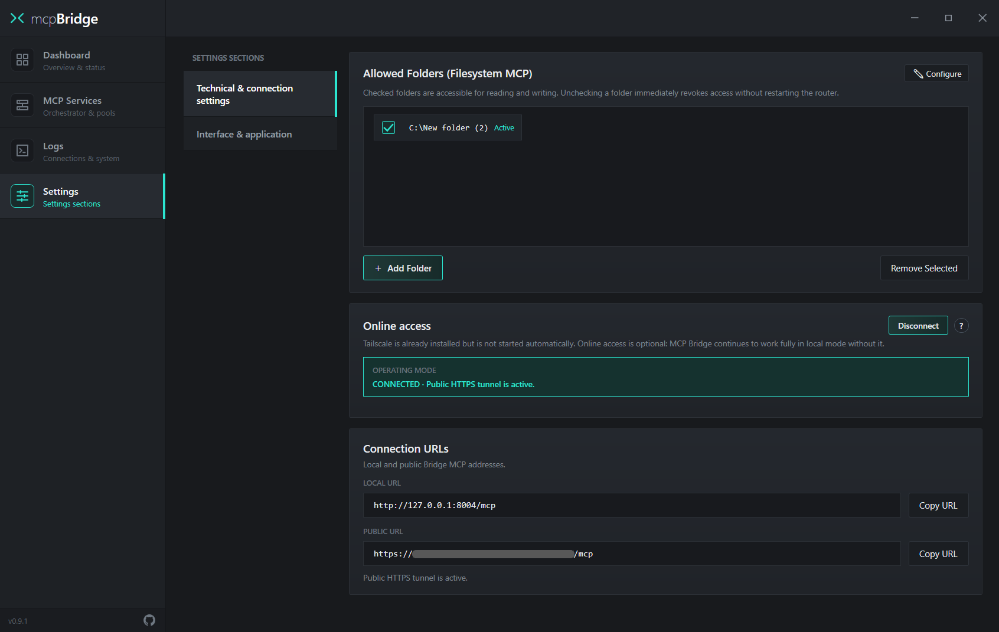
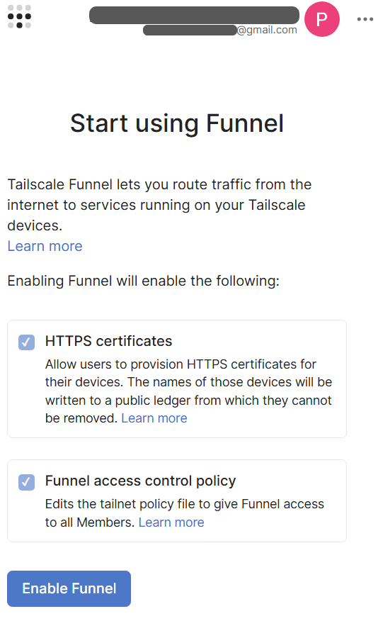

  <a href="docs/donate.md" title="Support the project"> Support</a> ·
  <a href="README.ru.md">Русский</a> · <a href="README.md">English</a>

  
  <h1>mcp<b>Bridge</b></h1>
  

    <b>A local MCP hub and server manager for Windows</b> 
    Connect your local MCP servers to browser-based AI or desktop clients through one endpoint.
  

  

    
  

  

## Why MCP Bridge?

Managing several MCP servers and their tools from an AI client can get cumbersome. MCP Bridge brings local and remote servers together in one app and gives your client a single endpoint to connect to.

With MCP Bridge, you can:

- connect multiple MCP servers through one endpoint;
- enable or disable servers during a chat;
- save server combinations as presets for different tasks;
- make local STDIO servers available to compatible browser-based AI clients through Tailscale Funnel.

A public tunnel is not required for local desktop clients. Tailscale Funnel is an optional way to let a web-based client reach your Bridge over the internet.

## Demo

<video src="https://github.com/user-attachments/assets/6b1b49db-0a66-40c0-ac24-ed31efa85cad" width="900" controls muted playsinline>Your browser does not support embedded video.</video>

The demo shows how to disable MCP servers you are not using during an active conversation.

## Quick start

1. Download the installer from the [latest release](https://github.com/Darek3399/MCP-Bridge/releases/latest).
2. Install and launch MCP Bridge.
3. Open **MCP Services** and add an MCP server. You can paste its configuration from the server's documentation.
4. Click **Verify & Add**. If the server depends on an app that is currently closed, choose **Save Without Check**.
5. In your MCP client's settings, add a **Streamable HTTP** connection and use this local URL:

   `http://127.0.0.1:8004/mcp`

  

### Remote access with Tailscale Funnel

The first time you set up public access, authorize your device with Tailscale and enable Funnel. After that, Bridge uses the device's stable name and Funnel URL; you generally do not need to sign in again or get a new URL every time Bridge starts. The URL remains available while the device is authorized and running and Funnel is enabled.

Unlike temporary tunnels, the URL does not need to be reacquired on every launch. Other tunnel providers may offer persistent addresses only on paid plans; terms vary by service.

> **Security note:** The public URL may be reachable from the internet. Do not post it publicly, and enable Funnel only when remote access is needed.

  

## Features

### Switch servers during a chat

Enable and disable MCP servers during an active conversation without manually reconnecting your client.

  

### Presets for different tasks

Save a combination of servers as a preset and switch between setups for different workflows, such as development or working with files.

### Local STDIO servers

MCP Bridge brings local command-line MCP servers—started with tools such as `npx`, `uvx`, or `python`—into the shared gateway.

### Folder access controls

Choose which folders are available to the built-in Filesystem MCP server. Grant access only to directories needed for your task.

## How it works

  

1. Your AI client connects to the MCP Bridge endpoint.
2. Bridge routes requests to enabled MCP servers.
3. Local servers can use STDIO; remote servers can use HTTP.
4. If a browser-based client needs remote access, you can optionally enable Tailscale Funnel.

Bridge exposes two meta-tools, `all_tools` and `call_tool`, for discovering and calling tools from connected servers. This avoids sending every server's tool description to the client at once; the actual effect depends on the client and model.

## Security and limitations

- **Third-party MCP servers** run on your computer as your Windows user. Only add commands and servers you trust.
- **Filesystem MCP** can read, modify, and delete files in allowed folders. Avoid granting access to the entire drive unless needed.
- **Tailscale Funnel** exposes a public URL. Do not post it publicly, and disable Funnel when you do not need remote access.
- **Server secrets**—environment variables and authorization headers—are stored locally. According to the project's current documentation, they are stored in plain text; keep this in mind when handling keys and tokens.

See [SECURITY.md](SECURITY.md) for details.

## System requirements

- Windows 10 x64 (version 1903+) or Windows 11.
- .NET Framework 4.8.
- Download the Windows x64 installer from [GitHub Releases](https://github.com/Darek3399/MCP-Bridge/releases/latest).

## Technical details

- **Platform:** Windows.
- **UI languages:** Russian and English.
- **MCP transports:** STDIO and HTTP.
- **Local endpoint:** `http://127.0.0.1:8004/mcp`.
- **Meta-tools:** `all_tools` and `call_tool`.
- **Optional remote access:** Tailscale Funnel.
- **Child-process management:** Windows Job Objects.

## Contributing

Found a bug or have an idea for an improvement?

- [Open an issue](https://github.com/Darek3399/MCP-Bridge/issues).
- [Browse the source code](https://github.com/Darek3399/MCP-Bridge).

## License

See the [LICENSE](LICENSE) file for the project's terms.

## Support the project

If MCP Bridge is useful to you, you can support its development:

  

---

  <a href="README.ru.md">Русский</a> ·
  <a href="SECURITY.md">Security</a> ·
  <a href="THIRD_PARTY_NOTICES.md">Third-party notices</a> ·
  <a href="docs/donate.md">Support the project</a>

