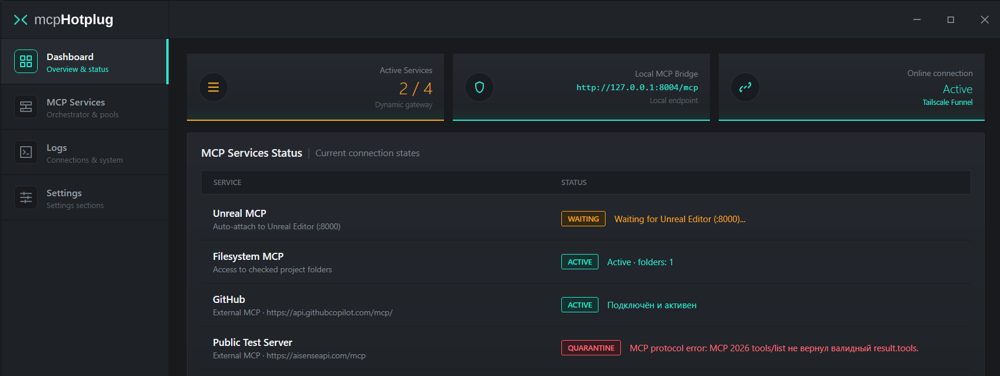
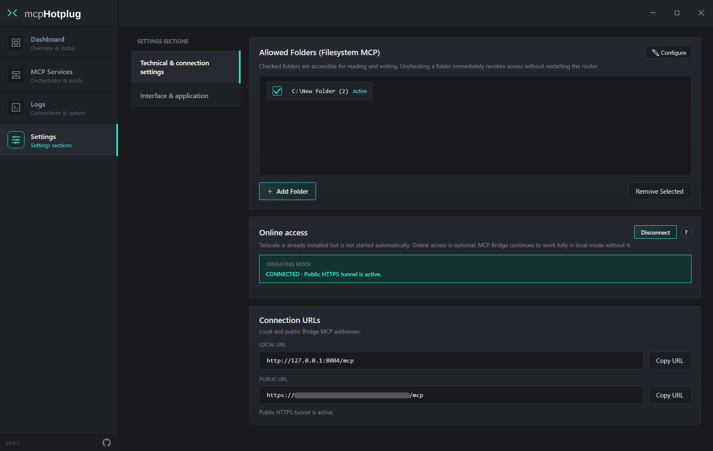
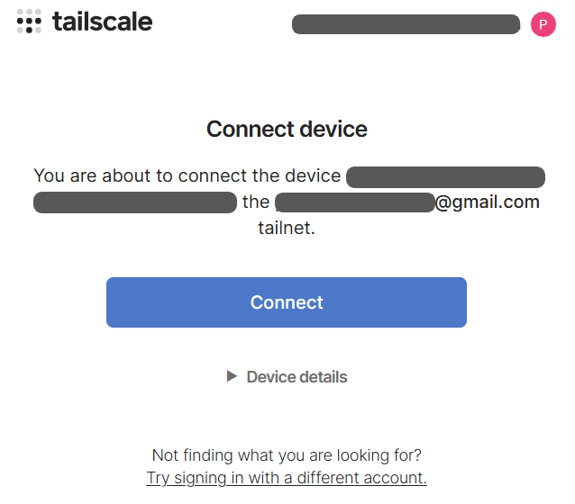
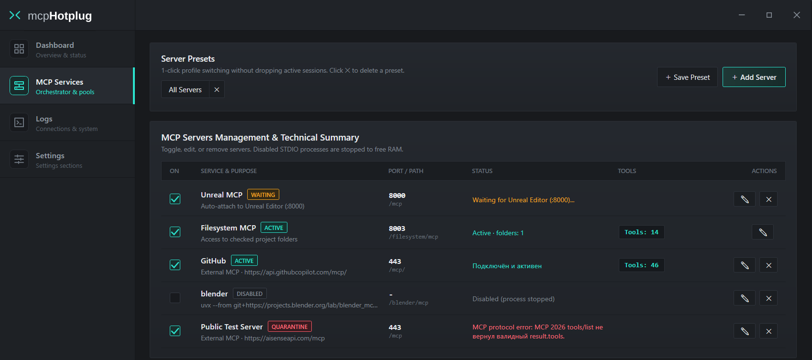
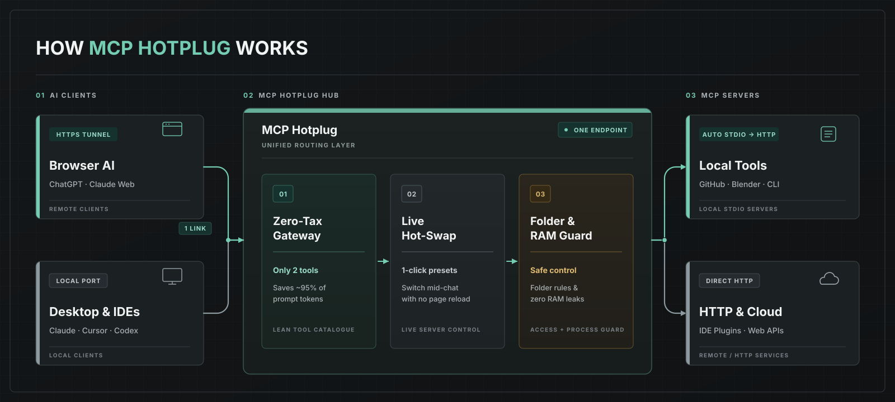

<div style="max-width: 1000px; margin: 0 auto;">

<div align="right" style="display: flex; justify-content: space-between; align-items: center; padding-top: 8px;">
  <span><a id="top"></a><a href="docs/donate.md" title="Support the project"></a></span>
  <span><a href="README.md"></a>&nbsp;<a href="README.ru.md"></a></span>
</div>

<div align="center">
  <br clear="all">
  
  <h1 style="margin-top: 0;">mcp<b>Hotplug</b></h1>

  <h3>One endpoint for all your MCP servers. Switch tools without restarting the chat.</h3>

  <p>
    MCP Hotplug combines local and remote MCP servers in one Windows app.<br>
    Connect your AI client once, then enable only the servers you need.
  </p>

  <p>
    <a href="#quick-start"></a>
    <a href="LICENSE"></a>
    <a href="https://mcp.so/server/MCP-Hotplug/Darek3399"></a>
    <a href="https://glama.ai/mcp/servers/Darek3399/MCP-Hotplug"></a>
  </p>


  <p><sub>Windows 10/11 · No public tunnel is required for local desktop clients</sub></p>
</div>

<p align="center">
  
</p>

## Why MCP Hotplug?

- **One stable gateway instead of juggling configs.** Connect local STDIO (`npx`, `uvx`, `python`) and remote HTTP servers once through `http://127.0.0.1:8004/mcp` (or the built-in STDIO bridge). To any AI client, it looks like a single steady MCP.
- **Cut token burn and skip tool caps.** At startup, your AI sees only 2 tools (`all_tools` and `call_tool`) instead of a hundred schemas. Tool descriptions load on demand and only from servers currently switched on, so you never hit the 40/80 tool cap in Cursor or Windsurf.
- **Toggle servers and presets mid-chat.** Turn MCP servers or task presets on and off in one click on the fly. Keep typing in the exact same conversation without editing JSON files, restarting your client, or refreshing browser tabs.
- **Auto-standby for Unreal Engine 5.8 (`:8000`), Blender, Unity, and IDEs.** Close your 3D editor or crash during a compile, and the AI session stays intact. The server drops into `WAITING`, reconnects on its own when the app comes back, and lets you launch programs in any order (built-in `Unreal MCP` profile included).
- **One static HTTPS URL for browser AI (ChatGPT, Gemini, Grok, claude.ai).** Built-in `Tailscale Funnel` (isolated with `accept-dns=false` so it will not touch your Windows DNS) turns your local servers into one permanent HTTPS link that never changes between launches.
- **Zero leftover `node.exe` or `uvx.exe` zombies in Task Manager.** Flipping a server off terminates the entire child process tree via a `Windows Job Object`, so nothing stays stuck eating RAM.
- **Batteries-included `.exe` with clean disk isolation.** Standard Windows installer with bundled `Node.js`, `uvx`, and `Filesystem MCP` (folder permissions are checkboxes in the UI, no terminal needed). Any `npm` packages download strictly into the app folder and wipe cleanly if you remove a server later.

> **Coming soon:** toggling individual tools inside a single server (for example, keeping 7 needed tools out of 14 in Filesystem or trimming heavy sets like Unreal `All Toolsets`) to cut token waste even further and keep models focused.
>
> *No tunnel is needed for local desktop clients (Claude Desktop, Cursor, Windsurf, etc.). Point them straight to `http://127.0.0.1:8004/mcp`.*

## Quick start

1. Download the installer from the [latest release page](https://github.com/Darek3399/MCP-Hotplug/releases/latest), or install via **WinGet**:

   ```powershell
   winget install Darek3399.MCPHotplug
   ```
2. Install and launch MCP Hotplug.
3. Open **MCP Services** and add an MCP server. You can paste its configuration from the server documentation.
4. Click **Verify & Add**. If the server depends on an app that is currently closed, choose **Save Without Check**.
5. In your MCP client settings, add a **Streamable HTTP** connection and use this local URL:

   `http://127.0.0.1:8004/mcp`

If your client uses a JSON configuration file, add:

```json
{
  "mcpServers": {
    "mcp-hotplug": {
      "type": "http",
      "url": "http://127.0.0.1:8004/mcp"
    }
  }
}
```

<p>
  
</p>

## Remote access with Tailscale Funnel

During the initial setup, authorize your device in Tailscale and enable Funnel. After that, Hotplug uses the device's stable name and Funnel URL: you usually do not need to sign in again or obtain a new URL every time Hotplug starts. The address remains available while the device is authorized and running, and Funnel is enabled.

Unlike temporary tunnels, this address does not need to be reacquired on every launch. Terms vary by provider; some alternatives offer persistent addresses only on paid plans.

<table>
  <tr>
    <td width="33%" align="center" valign="top">
      
      <br><b>1. Launch Tailscale</b>
    </td>
    <td width="33%" align="center" valign="top">
      
      <br><b>2. Sign in once</b>
    </td>
    <td width="33%" align="center" valign="top">
      
      <br><b>3. Enable Funnel</b>
    </td>
  </tr>
</table>

> **Security note:** the public URL may be reachable from the internet. Do not share it publicly, and only enable Funnel when remote access is needed.

## Features

### Switch servers during a chat

Enable and disable MCP servers during an active conversation without manually reconnecting your client.

<p>
  
</p>

### Use presets for different tasks

Save a combination of servers as a preset and switch between setups for different workflows, such as development or working with files.

### Connect local STDIO servers

Hotplug brings local command-line MCP servers—started with tools such as `npx`, `uvx`, `python`, and others—into a shared gateway.

### Limit access to folders

For the built-in Filesystem MCP server, choose which folders are available. Grant access only to the directories needed for your task.

## How it works

<p>
  
</p>

1. Your AI client connects to the MCP Hotplug endpoint.
2. Hotplug routes requests to enabled MCP servers.
3. Local servers can use STDIO; remote servers can use HTTP.
4. If a browser-based client needs remote access, it can be enabled separately through Tailscale Funnel.

## Tools

Hotplug exposes two meta-tools — `all_tools` and `call_tool` — for discovering and calling tools from connected servers. This avoids sending every server's tool description to the client at once; the actual effect depends on the client and model.

- **`all_tools`** — returns the latest cached tool catalog snapshot from enabled MCP servers, including `tool_id`, `inputSchema`, per-server status, and `catalog_revision`.
- **`call_tool`** — validates arguments against the cached `inputSchema` and routes the call to the target server using `tool_id`, `catalog_revision`, and `arguments`.

## Security and limitations

- **Third-party MCP servers** run on your computer as your Windows user. Only add commands and servers you trust.
- **Filesystem MCP** can read, modify, and delete files in allowed folders. Avoid granting access to the entire drive unless needed.
- **Tailscale Funnel** exposes a public URL. Do not share it publicly, and disable Funnel when you do not need remote access.
- **Server secrets** — environment variables and authorization headers — are stored locally. According to the project's current documentation, they are stored in plain text; keep this in mind when handling keys and tokens.

See [SECURITY.md](SECURITY.md) for details.

## System requirements

- Windows 10 x64 (version 1903+) or Windows 11.
- .NET Framework 4.8.
- Download the Windows x64 installer from [GitHub Releases](https://github.com/Darek3399/MCP-Hotplug/releases/latest).

## Technical details

- **Platform:** Windows.
- **UI languages:** Russian and English.
- **MCP transports:** STDIO and HTTP.
- **Local endpoint:** `http://127.0.0.1:8004/mcp`.
- **Meta-tools:** `all_tools` and `call_tool`.
- **Optional remote access:** Tailscale Funnel.
- **Child-process management:** Windows Job Objects.

## Contributing

Found a bug or have an idea for an improvement?

- [Open an issue](https://github.com/Darek3399/MCP-Hotplug/issues).
- [Browse the source code](https://github.com/Darek3399/MCP-Hotplug).

## License

Released under the [MIT License](LICENSE).

## Support the project

If MCP Hotplug is useful to you, you can support its development:

<p>
  <a href="docs/donate.md">
    
  </a>
</p>

---

<p align="center">
  <a href="README.ru.md">Русский</a> ·
  <a href="SECURITY.md">Security</a> ·
  <a href="THIRD_PARTY_NOTICES.md">Third-party notices</a>
</p>

</div>
