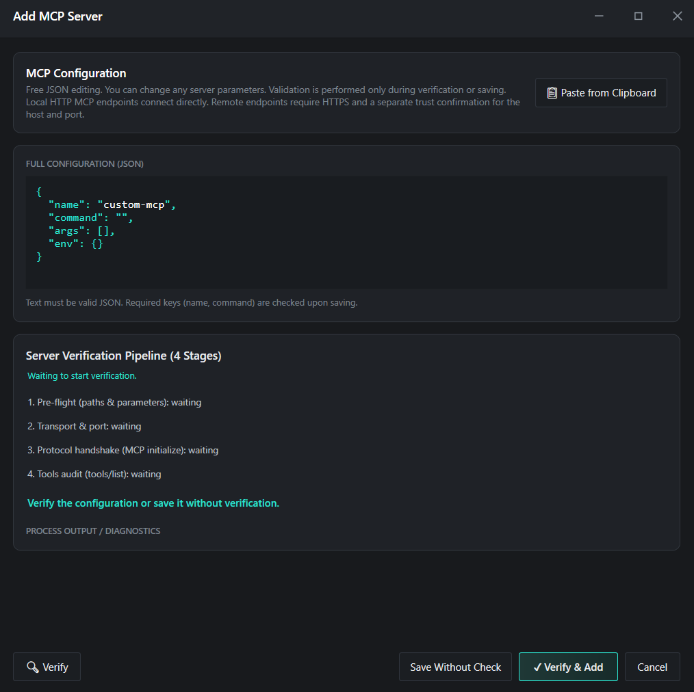

  &nbsp;&nbsp;

  
  <h1>mcp<b>Bridge</b></h1>
  

    <b>Unified Local Hub & MCP Server Manager for Windows</b> 
    Connect all your local MCP servers to any <b>Browser AI or Desktop client</b> via a single link — powered by <b>Zero-Tax Hot-Swap</b> architecture and managed from one window.
  

  

    
  

  

    &nbsp;
    &nbsp;
    &nbsp;
    &nbsp;
    &nbsp;
    &nbsp;
    
  

 

<!-- ===================================================================== -->
<!-- 01. WHY MCP BRIDGE                                                    -->
<!-- ===================================================================== -->

<table>
  
  <tbody>
    <tr>
      <td width="500" valign="top">
        

          
<b><ins>Zero-Tax Hot-Swap: Token Saving &amp; Live Switching</ins></b>  Instead of loading 50–150 heavy tool schemas into every prompt, the gateway exposes only 2 lightweight meta-tools (<code>all_tools</code> and <code>call_tool</code>) — cutting the token tax to zero. Enable or disable servers and presets mid-conversation, with no chat-page reload.

           
          In standard clients, tool schemas from every connected server remain in context even when idle. MCP Bridge exposes only 2 lightweight meta-tools (<code>all_tools</code> and <code>call_tool</code>) upfront, and whenever you uncheck an unused server in the app window, its schemas are immediately excluded from the gateway catalogue — without restarting the chat or losing conversation history.
        

      </td>
      <td width="500" valign="top">
        

          
<b><ins>One Connection, 1-Click Presets &amp; Smart Import</ins></b>  Connect your AI client once, switch ready-made server presets in 1 click, and smart-import clipboard content with automatic recognition of <code>mcpServers</code> JSON, CLI commands, and URLs.

           
          Group servers into task-specific Server Presets and switch workflows in 1 click without dropping active sessions. When adding a new server, smart clipboard import automatically parses <code>mcpServers</code> JSON blocks, CLI commands, or URLs.
        

      </td>
    </tr>
  </tbody>
  
  <tbody>
    <tr>
      <td width="500" valign="top">
        

          
<b><ins>Local STDIO Servers for Browser AI</ins></b>  Bridge combines all your local console servers (<code>npx</code>, <code>uvx</code>, <code>python</code>) into one protected <code>HTTPS</code> link for Browser AI using built-in <code>Supergateway</code> + <code>Tailscale Funnel</code> — no router port forwarding and no changes to system DNS (<code>accept-dns=false</code>).

           
          Built-in <code>Supergateway</code> and <code>Tailscale Funnel</code> expose local STDIO servers over <code>Streamable HTTP</code> without router port forwarding and without modifying Windows DNS settings (<code>accept-dns=false</code>). Pre-existing Tailscale installations and preferences are preserved untouched.
        

      </td>
      <td width="500" valign="top">
        

          
<b><ins>Process &amp; RAM Control — No Zombie Processes</ins></b>  A lightweight native tray app. When a server is stopped or Bridge exits, the Windows <code>Job Object</code> kills the entire child-process tree — no orphaned <code>node.exe</code> or <code>python.exe</code> left running in memory.

           
          Managed child processes are assigned to a <code>Windows Job Object</code> (<code>JOB_OBJECT_LIMIT_KILL_ON_JOB_CLOSE</code>). Additional descendant cleanup (<code>Toolhelp</code>) and startup WMI/TCP checks help terminate Bridge-managed process trees and prevent orphaned <code>node.exe</code> or <code>python.exe</code> processes.
        

      </td>
    </tr>
  </tbody>
  
  <tbody>
    <tr>
      <td width="500" valign="top">
        

          
<b><ins>Verification Sandbox, Quarantine &amp; Auto-Wait</ins></b>  Local plugins sleep in <code>WAITING</code> until their target app starts (e.g. an IDE, Blender/Unity, or a database); failing servers move to <code>QUARANTINE</code> after a 4-stage verification.

           
          New servers pass through a 4-stage verification pipeline (<code>Pre-flight</code> → <code>Transport</code> → <code>Initialize</code> → <code>Tools</code>). Lightweight socket hooks automatically detect whether a STDIO server connects to a local application port (e.g., a 3D editor, IDE, or local DB) or a remote API, keeping the server in <code>WAITING</code> while the target app is closed.
        

      </td>
      <td width="500" valign="top">
        

          
<b><ins>Live Folder Security &amp; Everything Included</ins></b>  Control folder access on the fly with checkboxes (<code>roots-filter</code>), automatically redact secrets as <code>[REDACTED]</code>, and get <code>Node.js</code>, <code>uv</code>, <code>Filesystem MCP</code>, and <code>Tailscale</code> bundled in the installer.

           
          The internal <code>roots-filter</code> strips client-supplied <code>roots</code> capabilities on <code>initialize</code> so remote clients cannot override your local folder allow-list. Remote servers require explicit per-origin HTTPS trust approval, and API keys or Bearer tokens are automatically redacted (<code>[REDACTED]</code>) in logs.
        

      </td>
    </tr>
  </tbody>
</table>

<table>
  <thead>
    <tr>
      <th width="1000" align="left"><h3>Live Demo: Saving Context Tokens by Disabling Unused MCP Servers on the Fly</h3></th>
    </tr>
  </thead>
  <tbody>
    <tr>
      <td width="1000">
        When you dynamically disable unused MCP servers in <b>MCP Bridge</b> right during an active chat, their tools immediately stop being sent to the dialogue <b>without reloading the browser page</b> — drastically reducing context token consumption:  
        <video src="https://github.com/user-attachments/assets/6b1b49db-0a66-40c0-ac24-ed31efa85cad" width="974" style="max-width: 100%; height: auto; display: block;" controls muted playsinline></video>
      </td>
    </tr>
  </tbody>
</table>

 

 

<!-- ===================================================================== -->
<!-- 02. INITIAL SETUP & CONNECTION                                        -->
<!-- ===================================================================== -->

Open the <b>Settings</b> tab — here you configure folder access, the public tunnel, and copy the connection URLs for your AI client:

<table>
  <thead>
    <tr>
      <th width="333" align="left"><h3>1. Allowed Folders</h3></th>
      <th width="333" align="left"><h3>2. Online access</h3></th>
      <th width="334" align="left"><h3>3. Connection URLs</h3></th>
    </tr>
  </thead>
  <tbody>
    <tr>
      <td width="333" valign="top">
        Directories accessible to the built-in <code>Filesystem MCP</code>. Uncheck any folder to revoke AI access immediately without restarting the gateway.
      </td>
      <td width="333" valign="top">
        Enables the public HTTPS tunnel via <code>Tailscale Funnel</code>. Required only for web-based AI apps. Local desktop clients on your PC work without it.
      </td>
      <td width="334" valign="top">
        Ready-to-use gateway endpoints. Click <code>Copy URL</code> next to the address you need and paste it into your AI client settings.
      </td>
    </tr>
  </tbody>
</table>

<table>
  <thead>
    <tr>
      <th width="500" align="left"><h3>LOCAL URL — <code>http://127.0.0.1:8004/mcp</code></h3></th>
      <th width="500" align="left"><h3>PUBLIC URL — <code>https://&lt;device&gt;.&lt;tailnet&gt;.ts.net/mcp</code></h3></th>
    </tr>
  </thead>
  <tbody>
    <tr>
      <td width="500" valign="top">
        For applications installed on your PC (IDEs, desktop AI clients, local agents). Add a <code>Streamable HTTP</code> connection in your app's MCP settings and paste this URL.
      </td>
      <td width="500" valign="top">
        For web AI applications that support MCP. Depending on the service, this section may be called <i>connectors, plugins, integrations</i>, or connected via third-party extensions — simply paste the copied URL there.
      </td>
    </tr>
  </tbody>
</table>

 

<!-- ===================================================================== -->
<!-- 03. TAILSCALE AUTHORIZATION                                           -->
<!-- ===================================================================== -->

When clicking <code>Connect</code> under <i>Online access</i> for the first time, complete these three screens in order:

<table>
  <thead>
    <tr>
      <th width="333" align="left"><h3>STEP 1 · Welcome to Tailscale</h3></th>
      <th width="333" align="left"><h3>STEP 2 · Sign In & Connect</h3></th>
      <th width="334" align="left"><h3>STEP 3 · Start using Funnel</h3></th>
    </tr>
  </thead>
  <tbody>
    <tr>
      <td width="333" valign="top">
          
        The Tailscale application window will open. Click <code>Get Started</code>.
      </td>
      <td width="333" valign="top">
          
        A login page will open in your browser — <b>sign in to your account</b>, then click <code>Connect</code> on the <i>Connect device</i> screen.
      </td>
      <td width="334" valign="top">
          
        The <code>Start using Funnel</code> page will open automatically. Scroll down, click <code>Enable Funnel</code>, and wait for the connection to finish.
      </td>
    </tr>
  </tbody>
</table>

 

<!-- ===================================================================== -->
<!-- 04. MAIN SCREEN (DASHBOARD)                                           -->
<!-- ===================================================================== -->

The <code>Dashboard</code> tab shows the gateway overview and currently enabled servers. Disabled servers (<code>DISABLED</code>) are hidden from the <i>MCP Services Status</i> table to keep it clean — they are visible in the <i>MCP Services</i> tab.

<table>
  <thead>
    <tr>
      <th width="250" align="left"></th>
      <th width="250" align="left"></th>
      <th width="250" align="left"></th>
      <th width="250" align="left"></th>
    </tr>
  </thead>
  <tbody>
    <tr>
      <td width="250" valign="top">The server is connected, verified, and exposing its tools to the chat.</td>
      <td width="250" valign="top">Waiting for a local application or endpoint to become available (e.g., an IDE, 3D editor, or local service).</td>
      <td width="250" valign="top">Startup or MCP protocol error. The server is isolated so other services keep working.</td>
      <td width="250" valign="top">Manually disabled by the user (shown only in the <i>MCP Services</i> tab).</td>
    </tr>
  </tbody>
</table>

 

<!-- ===================================================================== -->
<!-- 05. MANAGING MCP SERVERS & PRESETS                                    -->
<!-- ===================================================================== -->

<table>
  <thead>
    <tr>
      <th width="1000" align="left"><h3>How Real-Time Server Switching Works</h3></th>
    </tr>
  </thead>
  <tbody>
    <tr>
      <td width="1000">
        You can enable or disable any servers right during an active conversation with the AI. At any given moment, <b>only the tools belonging to currently enabled servers</b> are available in the dialogue. You <b>do not need to reload the browser page</b>, restart your local client, or manually refresh the tool list in your AI settings — the gateway updates the available tools automatically.
      </td>
    </tr>
  </tbody>
</table>

<table>
  <thead>
    <tr>
      <th width="333" align="left"><h3>Server Presets</h3></th>
      <th width="333" align="left"><h3>Enable (ON) & Tools</h3></th>
      <th width="334" align="left"><h3>Edit & Remove</h3></th>
    </tr>
  </thead>
  <tbody>
    <tr>
      <td width="333" valign="top">
        Click <code>Save Preset</code> to save the currently enabled combination of servers. Switch between saved profiles in 1 click without interrupting your session.
      </td>
      <td width="333" valign="top">
        The <code>ON</code> checkbox makes a server available to the chat. When disabled, Bridge stops its managed process tree through Windows Job Objects, releasing the memory used by those processes. <code>Tools: N</code> shows the number of available tools.
      </td>
      <td width="334" valign="top">
        The <b>✎</b> button opens the JSON configuration editor for the selected server, and <b>✕</b> removes the server from the list.
      </td>
    </tr>
  </tbody>
</table>

<table>
  <thead>
    <tr>
      <th width="1000" align="left"><h3>Under the Hood: 2-Meta-Tool Architecture (<code>all_tools</code> &amp; <code>call_tool</code>)</h3></th>
    </tr>
  </thead>
  <tbody>
    <tr>
      <td width="1000">
        <b>MCP Bridge</b> uses <b>Model-Directed Tool Discovery (MTD)</b>: a model-directed way to discover and invoke tools. The external gateway at <code>:8004/mcp</code> exposes only 2 meta-tools: <code>all_tools</code> and <code>call_tool</code>. Unlike semantic Smart Routing — where an external mechanism guesses relevant tools by keyword similarity — with MTD the model requests the live catalogue snapshot through <code>all_tools</code> (served from the internal Poll Manager cache with <code>catalog_revision</code> tracking), selects the exact tool it needs, and invokes it via <code>call_tool</code> with JSON Schema validation. This also eliminates reliance on how individual AI clients handle <code>notifications/tools/list_changed</code> or cache <code>tools/list</code>.
      </td>
    </tr>
  </tbody>
</table>

 

<!-- ===================================================================== -->
<!-- 06. ADDING AN MCP SERVER                                              -->
<!-- ===================================================================== -->

Click <code>+ Add Server</code> in the <i>MCP Services</i> tab to add a new local or remote server:

<table>
  <thead>
    <tr>
      <th width="333" align="left"><h3>1. Paste JSON</h3></th>
      <th width="333" align="left"><h3>2. Verify & Add</h3></th>
      <th width="334" align="left"><h3>3. Save Without Check</h3></th>
    </tr>
  </thead>
  <tbody>
    <tr>
      <td width="333" valign="top">
        Copy a standard <code>mcpServers</code> block from the server's documentation and click <code>Paste from Clipboard</code> (or edit the JSON manually).
      </td>
      <td width="333" valign="top">
        Click <b>Verify & Add</b> — Bridge will test the startup, discover its tools, and immediately attach the server to the gateway.
      </td>
      <td width="334" valign="top">
        If the server depends on an external app that is currently closed, click <code>Save Without Check</code> — it will be added in <code>WAITING</code> mode.
      </td>
    </tr>
  </tbody>
</table>

 

<!-- ===================================================================== -->
<!-- 07. SECURITY & USER RESPONSIBILITY                                    -->
<!-- ===================================================================== -->

<table>
  <thead>
    <tr>
      <th width="500" align="left"><h3>1. Full Access to Allowed Folders</h3></th>
      <th width="500" align="left"><h3>2. Running Third-Party STDIO Processes</h3></th>
    </tr>
  </thead>
  <tbody>
    <tr>
      <td width="500" valign="top">
        The built-in <code>Filesystem MCP</code> grants the AI permission to read, modify, and delete files inside checked directories in <code>Allowed Folders</code>. Never expose entire system drives (<code>C:\</code>) or folders containing passwords, wallets, or SSH keys.
      </td>
      <td width="500" valign="top">
        Any CLI server you add (<code>npx</code>, <code>uvx</code>, <code>python</code>, <code>node</code>, <code>.exe</code>) runs on your PC under your Windows user account. Only add servers and packages from sources you completely trust.
      </td>
    </tr>
  </tbody>
  <thead>
    <tr>
      <th width="500" align="left"><h3>3. Public Tailscale Funnel URL</h3></th>
      <th width="500" align="left"><h3>4. Local Storage of Keys & Tokens</h3></th>
    </tr>
  </thead>
  <tbody>
    <tr>
      <td width="500" valign="top">
        When the tunnel is enabled, your <code>PUBLIC URL</code> is reachable from the internet by anyone who knows the address. Never share this URL publicly or expose it in screenshots, and click <code>Disconnect</code> when you no longer need remote access.
      </td>
      <td width="500" valign="top">
        Configured environment variables (<code>env</code>) and HTTP authorization headers (<code>Authorization</code> / API keys) are stored locally in plain text inside <code>Config/settings.json</code>. Do not share this file with others.
      </td>
    </tr>
  </tbody>
</table>

 

  

  
    <h3>System Requirements</h3> Windows 10 x64 (1903+) / Windows 11 x64 · .NET Framework 4.8 
    <a href="SECURITY.md">Security</a> · <a href="THIRD_PARTY_NOTICES.md">Third-Party Notices</a>
  

