

  &nbsp;&nbsp;

  
  <h1>mcp<b>Bridge</b></h1>
  

    <b>Единый локальный хаб и менеджер MCP-серверов для Windows</b> 
    Подключите Bridge к своему AI-клиенту один раз и управляйте всеми серверами из одного окна.
  

  

    
  

  

    &nbsp;
    &nbsp;
    &nbsp;
    &nbsp;
    &nbsp;
    &nbsp;
    
  

 

<!-- ===================================================================== -->
<!-- 01. ЗАЧЕМ НУЖЕН MCP BRIDGE                                            -->
<!-- ===================================================================== -->

<a href="#sec-why">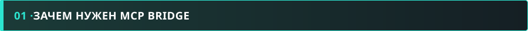</a>

<table>
  <thead>
    <tr>
      <th width="500" align="left">Чистый контекст ИИ без лишних команд</th>
      <th width="500" align="left">Одно подключение вместо десятков</th>
    </tr>
  </thead>
  <tbody>
    <tr>
      <td width="500" valign="top">
        Если подключить к ИИ сразу десяток серверов (50–100 инструментов), нейросеть начинает путаться в вызовах и тратить токены. Через Bridge вы включаете нужные серверы <b>прямо посреди диалога</b> — без перезапуска чата.
      </td>
      <td width="500" valign="top">
        Вместо ручной правки JSON-конфигов в каждом отдельном AI-клиенте вы один раз подключаете адрес Bridge, а все остальные серверы добавляете и переключаете внутри одного окна.
      </td>
    </tr>
  </tbody>
  <thead>
    <tr>
      <th width="500" align="left">Локальные STDIO-серверы в веб-приложениях ИИ</th>
      <th width="500" align="left">Контроль памяти и всё в комплекте</th>
    </tr>
  </thead>
  <tbody>
    <tr>
      <td width="500" valign="top">
        Большинство MCP-серверов работают только локально через консоль (<code>npx</code>, <code>uvx</code>, <code>python</code>), а веб-сервисы требуют внешний <code>HTTPS</code>. Bridge сам превращает любой локальный сервер в защищённую ссылку.
      </td>
      <td width="500" valign="top">
        Выключенные серверы не висят фоновыми процессами — Bridge полностью гасит их и освобождает ОЗУ. <code>Node.js</code>, <code>uv</code>, <code>Filesystem MCP</code> и <code>Tailscale</code> уже встроены в установщик.
      </td>
    </tr>
  </tbody>
</table>

 

<a href="https://pay.cloudtips.ru/p/cdb7341e">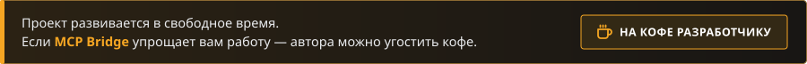</a>

 

<!-- ===================================================================== -->
<!-- 02. ПЕРВОНАЧАЛЬНАЯ НАСТРОЙКА                                          -->
<!-- ===================================================================== -->

<a href="#sec-settings">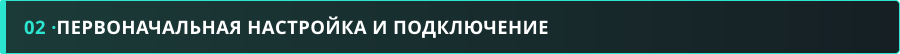</a>

Откройте вкладку <b>Settings</b> — здесь настраивается доступ к папкам, внешний туннель и находятся готовые ссылки для подключения ИИ:

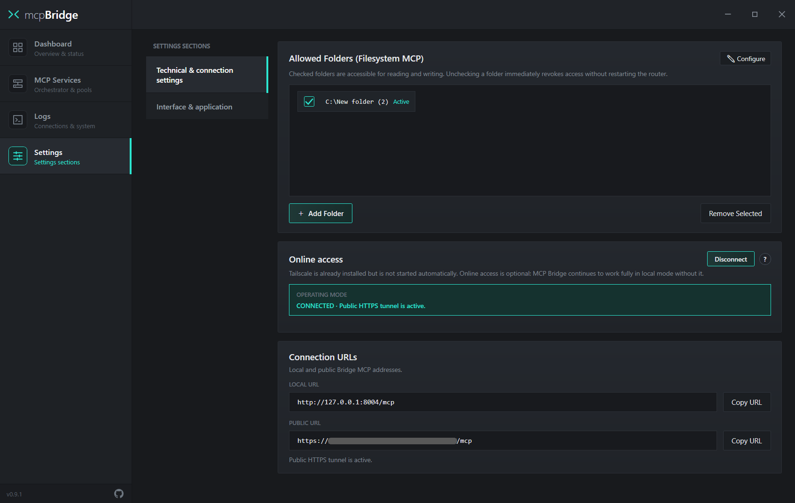

<table>
  <thead>
    <tr>
      <th width="333" align="left">1. Allowed Folders</th>
      <th width="333" align="left">2. Online access</th>
      <th width="334" align="left">3. Connection URLs</th>
    </tr>
  </thead>
  <tbody>
    <tr>
      <td width="333" valign="top">
        Папки, к которым разрешён доступ для встроенного <b>Filesystem MCP</b>. Снимите галочку — доступ для ИИ закроется мгновенно без перезапуска шлюза.
      </td>
      <td width="333" valign="top">
        Включение публичного HTTPS-туннеля через <b>Tailscale Funnel</b>. Нужен только для веб-приложений ИИ. Для программ на вашем ПК включать его не нужно.
      </td>
      <td width="334" valign="top">
        Готовые адреса шлюза. Нажмите <b>Copy URL</b> напротив нужного адреса и вставьте его в настройки своего AI-клиента.
      </td>
    </tr>
  </tbody>
</table>

<table>
  <thead>
    <tr>
      <th width="500" align="left">LOCAL URL — <code>http://127.0.0.1:8004/mcp</code></th>
      <th width="500" align="left">PUBLIC URL — <code>https://&lt;device&gt;.&lt;tailnet&gt;.ts.net/mcp</code></th>
    </tr>
  </thead>
  <tbody>
    <tr>
      <td width="500" valign="top">
        Для программ, установленных на вашем ПК (IDE, десктопные клиенты, локальные агенты). Укажите этот адрес как <code>Streamable HTTP</code> в настройках MCP вашей программы.
      </td>
      <td width="500" valign="top">
        Для веб-приложений ИИ с поддержкой MCP. В разных сервисах этот раздел называется по-разному — <i>коннекторы, плагины, интеграции</i> или подключается через расширения: просто вставьте туда этот адрес.
      </td>
    </tr>
  </tbody>
</table>

 

<!-- ===================================================================== -->
<!-- 03. АВТОРИЗАЦИЯ TAILSCALE                                             -->
<!-- ===================================================================== -->

<a href="#sec-tailscale">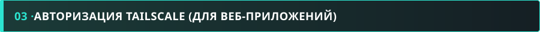</a>

При первом нажатии кнопки <b>Connect</b> в блоке <i>Online access</i> нужно пройти три экрана по очереди:

<table>
  <thead>
    <tr>
      <th width="333" align="left">ШАГ 1 · Welcome to Tailscale</th>
      <th width="333" align="left">ШАГ 2 · Авторизация и Connect</th>
      <th width="334" align="left">ШАГ 3 · Start using Funnel</th>
    </tr>
  </thead>
  <tbody>
    <tr>
      <td width="333" valign="top">
        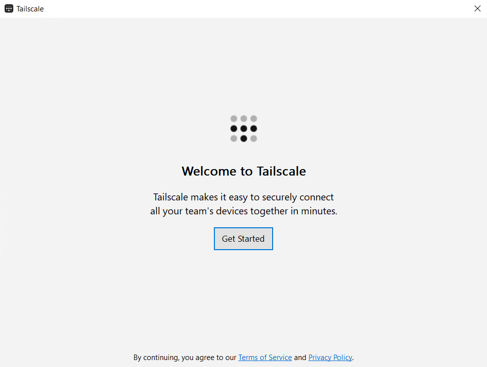  
        Откроется окно приложения Tailscale. Нажмите кнопку <b>Get Started</b>.
      </td>
      <td width="333" valign="top">
        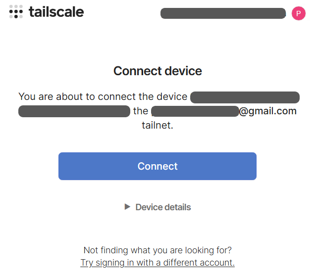  
        В браузере откроется форма входа — <b>авторизуйтесь</b>, после чего в окне <i>Connect device</i> нажмите <b>Connect</b>.
      </td>
      <td width="334" valign="top">
        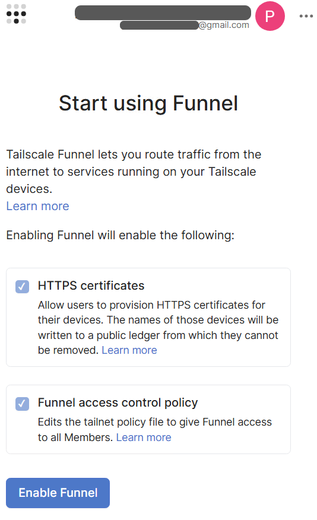  
        Откроется страница <b>Start using Funnel</b>. Прокрутите вниз, нажмите <b>Enable Funnel</b> и дождитесь подключения.
      </td>
    </tr>
  </tbody>
</table>

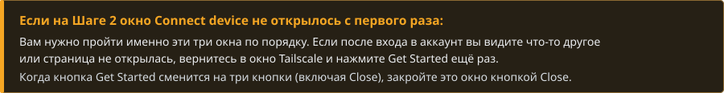

 

<!-- ===================================================================== -->
<!-- 04. ГЛАВНЫЙ ЭКРАН (DASHBOARD)                                         -->
<!-- ===================================================================== -->

<a href="#sec-dashboard">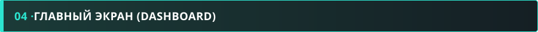</a>

На вкладке <b>Dashboard</b> отображается сводка по шлюзу и список включённых серверов. Выключенные серверы (<code>DISABLED</code>) в списке <i>MCP Services Status</i> скрыты — они находятся во вкладке <i>MCP Services</i>.

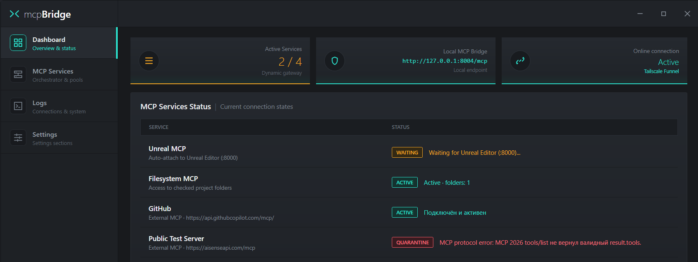

<table>
  <thead>
    <tr>
      <th width="250" align="left"></th>
      <th width="250" align="left"></th>
      <th width="250" align="left"></th>
      <th width="250" align="left"></th>
    </tr>
  </thead>
  <tbody>
    <tr>
      <td width="250" valign="top">Сервер подключён, проверен и передаёт свои инструменты в диалог.</td>
      <td width="250" valign="top">Ждёт запуска внешней программы (например, Unreal Editor на порту <code>:8000</code>).</td>
      <td width="250" valign="top">Ошибка запуска или протокола MCP. Сервер изолирован и не мешает остальным.</td>
      <td width="250" valign="top">Сервер выключен вручную (отображается только во вкладке <i>MCP Services</i>).</td>
    </tr>
  </tbody>
</table>

 

<!-- ===================================================================== -->
<!-- 05. УПРАВЛЕНИЕ СЕРВЕРАМИ И ПРЕСЕТАМИ                                  -->
<!-- ===================================================================== -->

<a href="#sec-servers">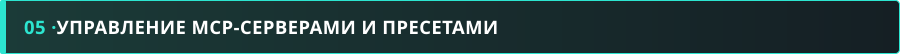</a>

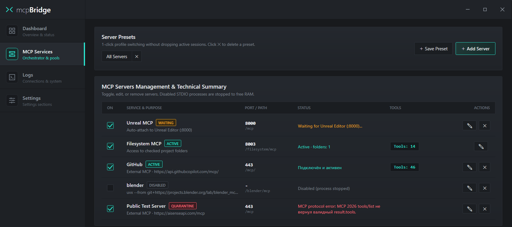

<table>
  <thead>
    <tr>
      <th width="1000" align="left">Как работает переключение серверов в реальном времени</th>
    </tr>
  </thead>
  <tbody>
    <tr>
      <td width="1000">
        Вы можете включать и выключать любые серверы прямо во время активного разговора с ИИ. В каждый момент времени в диалоге доступны <b>только инструменты тех серверов, которые включены прямо сейчас</b>. При этом <b>не нужно перезагружать страницу в браузере</b>, перезапускать локальный клиент или вручную обновлять список инструментов в настройках ИИ — шлюз передаёт изменения автоматически.
      </td>
    </tr>
  </tbody>
</table>

<table>
  <thead>
    <tr>
      <th width="333" align="left">Server Presets (Пресеты)</th>
      <th width="333" align="left">Включение (ON) и Tools</th>
      <th width="334" align="left">Редактирование и удаление</th>
    </tr>
  </thead>
  <tbody>
    <tr>
      <td width="333" valign="top">
        Отметьте нужную комбинацию серверов для конкретной задачи и нажмите <b>+ Save Preset</b>. Переключайте готовые профили в 1 клик прямо во время работы.
      </td>
      <td width="333" valign="top">
        Галочка <b>ON</b> мгновенно подключает сервер к диалогу или полностью гасит его процесс в памяти, а плашка <code>Tools: N</code> показывает число доступных инструментов.
      </td>
      <td width="334" valign="top">
        Кнопка <b>✎</b> открывает JSON-конфигурацию выбранного сервера для правки параметров, а <b>✕</b> удаляет сервер из списка.
      </td>
    </tr>
  </tbody>
</table>

 

<!-- ===================================================================== -->
<!-- 06. ДОБАВЛЕНИЕ MCP-СЕРВЕРА                                            -->
<!-- ===================================================================== -->

<a href="#sec-add">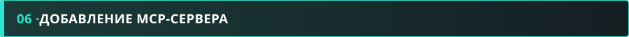</a>

Нажмите <b>+ Add Server</b> во вкладке <i>MCP Services</i>, чтобы подключить новый локальный или удалённый сервер:

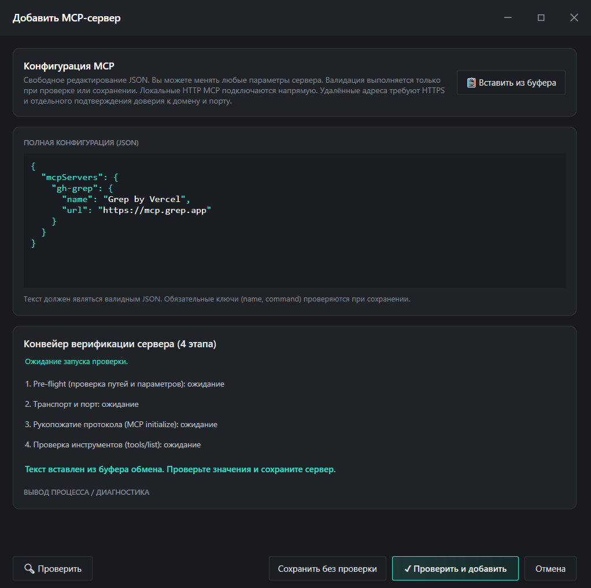

<table>
  <thead>
    <tr>
      <th width="333" align="left">1. Вставка JSON</th>
      <th width="333" align="left">2. Проверить и добавить</th>
      <th width="334" align="left">3. Сохранить без проверки</th>
    </tr>
  </thead>
  <tbody>
    <tr>
      <td width="333" valign="top">
        Скопируйте готовый блок <code>mcpServers</code> из документации нужного сервера и нажмите <b>Вставить из буфера</b> (или отредактируйте JSON вручную).
      </td>
      <td width="333" valign="top">
        Нажмите <b>Проверить и добавить</b> — Bridge протестирует запуск, проверит список инструментов и сразу подключит сервер к шлюзу.
      </td>
      <td width="334" valign="top">
        Если сервер зависит от внешней программы, которая сейчас закрыта, нажмите <b>Сохранить без проверки</b> — он добавится в режиме <code>WAITING</code>.
      </td>
    </tr>
  </tbody>
</table>

 

<!-- ===================================================================== -->
<!-- 07. БЕЗОПАСНОСТЬ И ОТВЕТСТВЕННОСТЬ ПОЛЬЗОВАТЕЛЯ                       -->
<!-- ===================================================================== -->

<a href="#sec-security">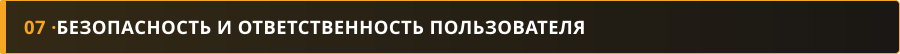</a>

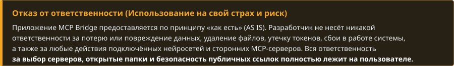

<table>
  <thead>
    <tr>
      <th width="500" align="left">1. Полный доступ к разрешённым папкам</th>
      <th width="500" align="left">2. Запуск сторонних STDIO-процессов</th>
    </tr>
  </thead>
  <tbody>
    <tr>
      <td width="500" valign="top">
        Встроенный <code>Filesystem MCP</code> даёт ИИ право читать, изменять и удалять любые файлы внутри отмеченных папок в <b>Allowed Folders</b>. Никогда не открывайте доступ к системным дискам целиком (<code>C:\</code>), папкам с паролями, криптокошельками или SSH-ключами.
      </td>
      <td width="500" valign="top">
        Любой добавленный вами консольный сервер (<code>npx</code>, <code>uvx</code>, <code>python</code>, <code>node</code>, <code>.exe</code>) выполняется на вашем ПК с правами вашей учётной записи Windows. Добавляйте только те серверы и пакеты, источнику которых вы полностью доверяете.
      </td>
    </tr>
  </tbody>
  <thead>
    <tr>
      <th width="500" align="left">3. Публичная ссылка Tailscale Funnel</th>
      <th width="500" align="left">4. Хранение ключей и токенов</th>
    </tr>
  </thead>
  <tbody>
    <tr>
      <td width="500" valign="top">
        При включённом туннеле ваш <code>PUBLIC URL</code> доступен из интернета любому, кто узнает этот адрес. Не публикуйте эту ссылку в открытом доступе, не светите её на скриншотах и отключайте туннель кнопкой <b>Disconnect</b>, когда он вам не нужен.
      </td>
      <td width="500" valign="top">
        Указанные вами переменные окружения (<code>env</code>) и HTTP-заголовки авторизации (<code>Authorization</code> / API-ключи) сохраняются локально в открытом виде в файле <code>Config/settings.json</code>. Не передавайте этот файл посторонним.
      </td>
    </tr>
  </tbody>
</table>

 

  

  
    <b>Системные требования:</b> Windows 10 x64 (1903+) / Windows 11 x64 · .NET Framework 4.8 
    <a href="docs/ARCHITECTURE.md">Архитектура</a> · <a href="SECURITY.md">Безопасность</a> · <a href="THIRD_PARTY_NOTICES.md">Сторонние компоненты</a> · <a href="CONTRIBUTING.md">Участие в разработке</a>
  

