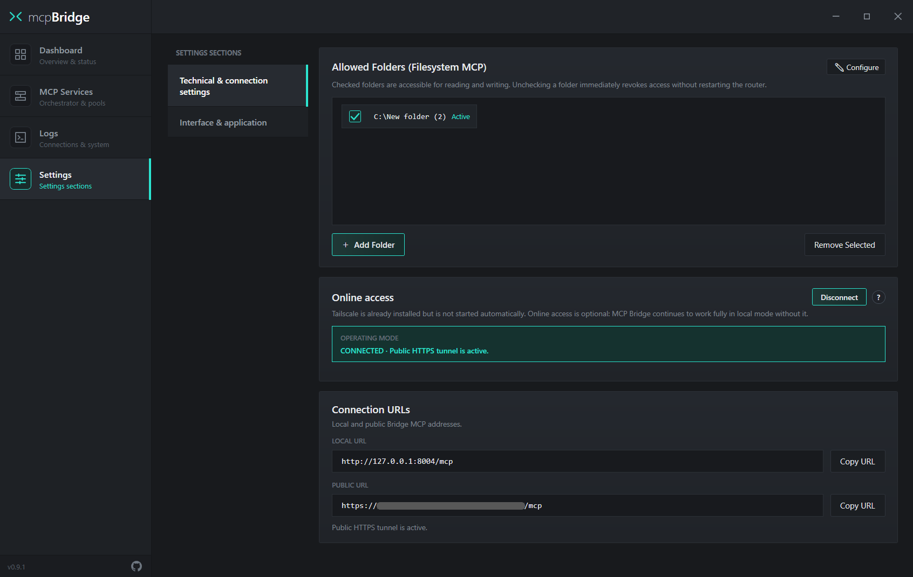
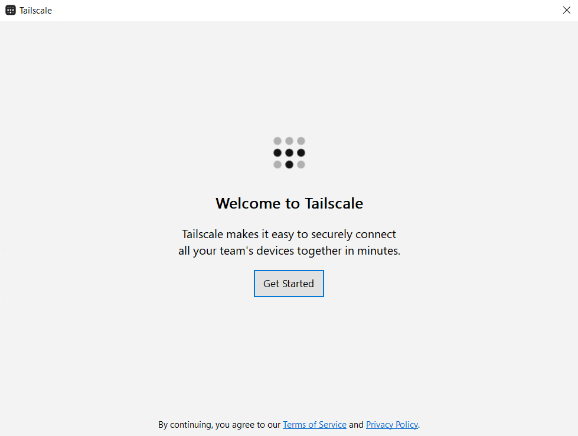
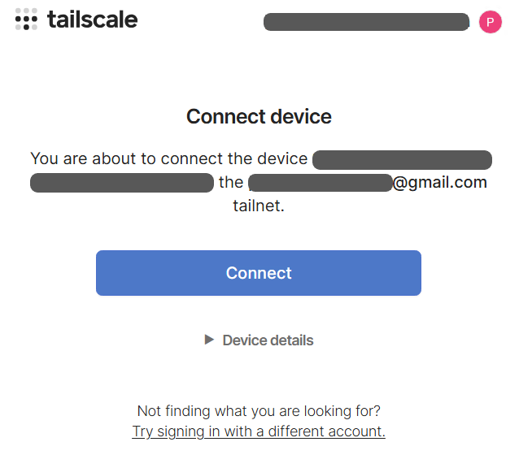
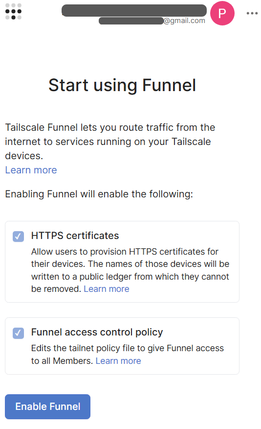
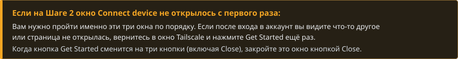
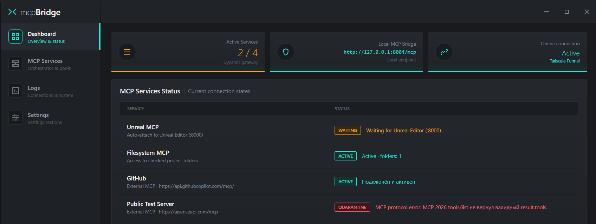
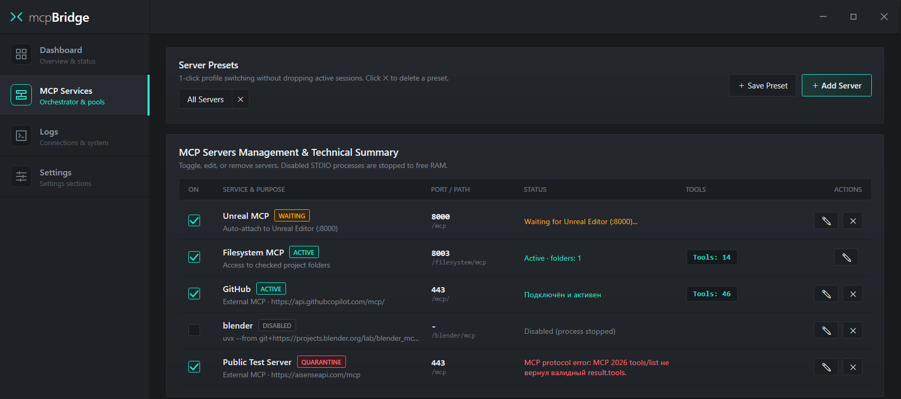
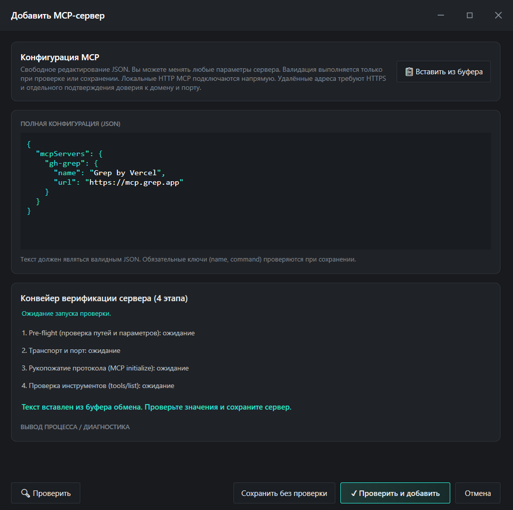
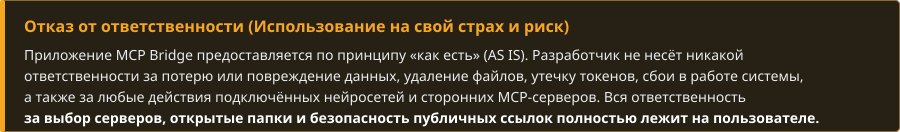

  &nbsp;&nbsp;

  
  <h1>mcp<b>Bridge</b></h1>
  

    <b>Единый локальный хаб и менеджер MCP-серверов для Windows</b> 
    Подключите все локальные MCP-серверы к <b>браузерному ИИ или десктопному клиенту</b> по одной ссылке — с архитектурой <b>Zero-Tax Hot-Swap</b> и управлением из одного окна.
  

  

    
  

  

    &nbsp;
    &nbsp;
    &nbsp;
    &nbsp;
    &nbsp;
    &nbsp;
    
  

 

<!-- ===================================================================== -->
<!-- 01. ЗАЧЕМ НУЖЕН MCP BRIDGE                                            -->
<!-- ===================================================================== -->

<table>
  
  <tbody>
    <tr>
      <td width="500" valign="top">
        

          
<b><ins>Zero-Tax Hot-Swap: экономия токенов и переключение на лету</ins></b>  Вместо загрузки 50–150 тяжёлых схем инструментов в каждый промпт шлюз публикует только 2 лёгких мета-инструмента (<code>all_tools</code> и <code>call_tool</code>), обнуляя «налог на токены» (Zero-Tax). Включайте и выключайте серверы и пресеты прямо посреди диалога — без перезагрузки страницы чата (Hot-Swap).

           
          В обычных клиентах описания всех подключённых инструментов висят в контексте постоянно, даже когда сервер не используется. В MCP Bridge шлюз публикует наружу только 2 лёгких мета-инструмента (<code>all_tools</code> и <code>call_tool</code>), а при выключении ненужного сервера в окне программы его схемы мгновенно исключаются из выдачи каталога — без перезапуска чата и без потери истории диалога.
        

      </td>
      <td width="500" valign="top">
        

          
<b><ins>Одно подключение, пресеты в 1 клик и умный импорт</ins></b>  Подключите AI-клиент один раз, переключайте готовые пресеты серверов в 1 клик, а умный импорт из буфера обмена сам распознаёт JSON <code>mcpServers</code>, CLI-команды и URL.

           
          Собирайте готовые профили серверов (Server Presets) под разные задачи и переключайте их одним кликом без разрыва сессии. При добавлении нового сервера умный импорт сам распознаёт блоки <code>mcpServers</code>, команды CLI или URL из буфера обмена.
        

      </td>
    </tr>
  </tbody>
  
  <tbody>
    <tr>
      <td width="500" valign="top">
        

          
<b><ins>Локальные STDIO-серверы в браузерном ИИ (Web)</ins></b>  Bridge объединяет все локальные консольные серверы (<code>npx</code>, <code>uvx</code>, <code>python</code>) в единую защищённую <code>HTTPS</code>-ссылку для браузерного ИИ через встроенные <code>Supergateway</code> + <code>Tailscale Funnel</code> — без проброса портов на роутере и без изменения системного DNS (<code>accept-dns=false</code>).

           
          Встроенная связка <code>Supergateway</code> и <code>Tailscale Funnel</code> пробрасывает локальные STDIO-серверы наружу по <code>Streamable HTTP</code> без проброса портов на роутере и без вмешательства в системный DNS Windows (<code>accept-dns=false</code>). Если Tailscale уже был установлен на ПК, Bridge бережно сохраняет ваши настройки.
        

      </td>
      <td width="500" valign="top">
        

          
<b><ins>Контроль памяти и фоновых процессов — без зомби-процессов</ins></b>  Лёгкое нативное приложение со сворачиванием в трей. При выключении сервера или выходе из Bridge системный <code>Windows Job Object</code> гарантированно завершает всё дерево дочерних процессов — в памяти не остаются зависшие <code>node.exe</code> и <code>python.exe</code>.

           
          Управляемые дочерние процессы привязываются к системному <code>Windows Job Object</code> (<code>JOB_OBJECT_LIMIT_KILL_ON_JOB_CLOSE</code>). Дополнительная очистка дерева потомков (<code>Toolhelp</code>) и проверка TCP-портов по WMI при запуске помогают завершать процессы Bridge и предотвращать появление бесхозных <code>node.exe</code> или <code>python.exe</code>.
        

      </td>
    </tr>
  </tbody>
  
  <tbody>
    <tr>
      <td width="500" valign="top">
        

          
<b><ins>Песочница проверки, карантин и авто-ожидание</ins></b>  Локальные плагины переходят в спящий режим <code>WAITING</code> до запуска целевой программы (например, IDE, Blender/Unity или СУБД), а сбойные серверы изолируются в <code>QUARANTINE</code> после 4-этапной проверки.

           
          Перед подключением сервер проходит 4-этапную проверку (<code>Pre-flight</code> → <code>Transport</code> → <code>Initialize</code> → <code>Tools</code>). Встроенные сокет-хуки автоматически определяют, стучится ли STDIO-сервер в локальный порт программы (например, 3D-редактора, IDE или БД) или во внешний API, переводя сервер в <code>WAITING</code>, пока программа закрыта.
        

      </td>
      <td width="500" valign="top">
        

          
<b><ins>Безопасность папок и всё включено</ins></b>  Управляйте доступом к папкам галочками на лету (<code>roots-filter</code>), автоматически скрывайте секреты как <code>[REDACTED]</code>, а <code>Node.js</code>, <code>uv</code>, <code>Filesystem MCP</code> и <code>Tailscale</code> уже получите в комплекте с установщиком.

           
          Фильтр <code>roots-filter</code> принудительно отсекает клиентские <code>roots</code> при <code>initialize</code>, поэтому удалённый клиент не может сам расширить себе доступ к дискам. Внешние серверы требуют явного подтверждения HTTPS-домена, а токены и ключи автоматически скрываются (<code>[REDACTED]</code>) в логах.
        

      </td>
    </tr>
  </tbody>
</table>

<table>
  <thead>
    <tr>
      <th width="1000" align="left"><h3>Демонстрация: как отключение лишних MCP на лету экономит токены</h3></th>
    </tr>
  </thead>
  <tbody>
    <tr>
      <td width="1000">
        Когда вы отключаете неиспользуемые серверы прямо во время диалога, их инструменты сразу перестают приходить в чат <b>без перезагрузки страницы в браузере</b>, что кратно снижает расход токенов на контекст:  
        <video src="https://github.com/user-attachments/assets/6b1b49db-0a66-40c0-ac24-ed31efa85cad" width="974" style="max-width: 100%; height: auto; display: block;" controls muted playsinline></video>
      </td>
    </tr>
  </tbody>
</table>

 

 

<!-- ===================================================================== -->
<!-- 02. ПЕРВОНАЧАЛЬНАЯ НАСТРОЙКА                                          -->
<!-- ===================================================================== -->

Откройте вкладку <b>Settings</b> — здесь настраивается доступ к папкам, внешний туннель и находятся готовые ссылки для подключения ИИ:

<table>
  <thead>
    <tr>
      <th width="333" align="left"><h3>1. Allowed Folders</h3></th>
      <th width="333" align="left"><h3>2. Online access</h3></th>
      <th width="334" align="left"><h3>3. Connection URLs</h3></th>
    </tr>
  </thead>
  <tbody>
    <tr>
      <td width="333" valign="top">
        Папки, к которым разрешён доступ для встроенного <code>Filesystem MCP</code>. Снимите галочку — доступ для ИИ закроется мгновенно без перезапуска шлюза.
      </td>
      <td width="333" valign="top">
        Включение публичного HTTPS-туннеля через <code>Tailscale Funnel</code>. Нужен только для веб-приложений ИИ. Для программ на вашем ПК включать его не нужно.
      </td>
      <td width="334" valign="top">
        Готовые адреса шлюза. Нажмите <code>Copy URL</code> напротив нужного адреса и вставьте его в настройки своего AI-клиента.
      </td>
    </tr>
  </tbody>
</table>

<table>
  <thead>
    <tr>
      <th width="500" align="left"><h3>LOCAL URL — <code>http://127.0.0.1:8004/mcp</code></h3></th>
      <th width="500" align="left"><h3>PUBLIC URL — <code>https://&lt;device&gt;.&lt;tailnet&gt;.ts.net/mcp</code></h3></th>
    </tr>
  </thead>
  <tbody>
    <tr>
      <td width="500" valign="top">
        Для программ, установленных на вашем ПК (IDE, десктопные клиенты, локальные агенты). Укажите этот адрес как <code>Streamable HTTP</code> в настройках MCP вашей программы.
      </td>
      <td width="500" valign="top">
        Для веб-приложений ИИ с поддержкой MCP. В разных сервисах этот раздел называется по-разному — <i>коннекторы, плагины, интеграции</i> или подключается через расширения: просто вставьте туда этот адрес.
      </td>
    </tr>
  </tbody>
</table>

 

<!-- ===================================================================== -->
<!-- 03. АВТОРИЗАЦИЯ TAILSCALE                                             -->
<!-- ===================================================================== -->

При первом нажатии кнопки <code>Connect</code> в блоке <i>Online access</i> нужно пройти три экрана по очереди:

<table>
  <thead>
    <tr>
      <th width="333" align="left"><h3>ШАГ 1 · Welcome to Tailscale</h3></th>
      <th width="333" align="left"><h3>ШАГ 2 · Авторизация и Connect</h3></th>
      <th width="334" align="left"><h3>ШАГ 3 · Start using Funnel</h3></th>
    </tr>
  </thead>
  <tbody>
    <tr>
      <td width="333" valign="top">
          
        Откроется окно приложения Tailscale. Нажмите кнопку <code>Get Started</code>.
      </td>
      <td width="333" valign="top">
          
        В браузере откроется форма входа — <b>авторизуйтесь</b>, после чего в окне <i>Connect device</i> нажмите <code>Connect</code>.
      </td>
      <td width="334" valign="top">
          
        Откроется страница <code>Start using Funnel</code>. Прокрутите вниз, нажмите <code>Enable Funnel</code> и дождитесь подключения.
      </td>
    </tr>
  </tbody>
</table>

 

<!-- ===================================================================== -->
<!-- 04. ГЛАВНЫЙ ЭКРАН (DASHBOARD)                                         -->
<!-- ===================================================================== -->

На вкладке <code>Dashboard</code> отображается сводка по шлюзу и список включённых серверов. Выключенные серверы (<code>DISABLED</code>) в списке <i>MCP Services Status</i> скрыты — они находятся во вкладке <i>MCP Services</i>.

<table>
  <thead>
    <tr>
      <th width="250" align="left"></th>
      <th width="250" align="left"></th>
      <th width="250" align="left"></th>
      <th width="250" align="left"></th>
    </tr>
  </thead>
  <tbody>
    <tr>
      <td width="250" valign="top">Сервер подключён, проверен и передаёт свои инструменты в диалог.</td>
      <td width="250" valign="top">Ожидание запуска или ответа целевой локальной программы / endpoint'а.</td>
      <td width="250" valign="top">Ошибка запуска или протокола MCP. Сервер изолирован и не мешает остальным.</td>
      <td width="250" valign="top">Сервер выключен вручную (отображается только во вкладке <i>MCP Services</i>).</td>
    </tr>
  </tbody>
</table>

 

<!-- ===================================================================== -->
<!-- 05. УПРАВЛЕНИЕ СЕРВЕРАМИ И ПРЕСЕТАМИ                                  -->
<!-- ===================================================================== -->

<table>
  <thead>
    <tr>
      <th width="1000" align="left"><h3>Как работает переключение серверов в реальном времени</h3></th>
    </tr>
  </thead>
  <tbody>
    <tr>
      <td width="1000">
        Вы можете включать и выключать любые серверы прямо во время активного разговора с ИИ. В каждый момент времени в диалоге доступны <b>только инструменты тех серверов, которые включены прямо сейчас</b>. При этом <b>не нужно перезагружать страницу в браузере</b>, перезапускать локальный клиент или вручную обновлять список инструментов в настройках ИИ — шлюз передаёт изменения автоматически.
      </td>
    </tr>
  </tbody>
</table>

<table>
  <thead>
    <tr>
      <th width="333" align="left"><h3>Server Presets (Пресеты)</h3></th>
      <th width="333" align="left"><h3>Включение (ON) и Tools</h3></th>
      <th width="334" align="left"><h3>Редактирование и удаление</h3></th>
    </tr>
  </thead>
  <tbody>
    <tr>
      <td width="333" valign="top">
        Отметьте нужную комбинацию серверов для конкретной задачи и нажмите <code>+ Save Preset</code>. Переключайте готовые профили в 1 клик прямо во время работы.
      </td>
      <td width="333" valign="top">
        Галочка <code>ON</code> подключает сервер к диалогу, а при выключении Bridge останавливает его управляемое дерево процессов через Windows Job Objects, освобождая используемую ими память. Плашка <code>Tools: N</code> показывает число доступных инструментов.
      </td>
      <td width="334" valign="top">
        Кнопка <b>✎</b> открывает JSON-конфигурацию выбранного сервера для правки параметров, а <b>✕</b> удаляет сервер из списка.
      </td>
    </tr>
  </tbody>
</table>

<table>
  <thead>
    <tr>
      <th width="1000" align="left"><h3>Как это устроено под капотом: архитектура двух мета-инструментов (<code>all_tools</code> и <code>call_tool</code>)</h3></th>
    </tr>
  </thead>
  <tbody>
    <tr>
      <td width="1000">
        <b>MCP Bridge</b> использует подход <b>Model-Directed Tool Discovery (MTD)</b> — обнаружение инструментов под управлением модели. На <code>:8004/mcp</code> внешний шлюз публикует только 2 мета-инструмента: <code>all_tools</code> и <code>call_tool</code>. В отличие от семантического Smart Routing, где внешний алгоритм пытается угадать нужные инструменты по близости слов, в MTD модель по необходимости запрашивает слепок каталога через <code>all_tools</code> (из кэша внутреннего Poll Manager с отслеживанием <code>catalog_revision</code>), сама выбирает подходящий инструмент и вызывает его через <code>call_tool</code> с проверкой аргументов по JSON Schema. Это исключает зависимость от того, как конкретный AI-клиент обрабатывает <code>notifications/tools/list_changed</code> и кэширует <code>tools/list</code>.
      </td>
    </tr>
  </tbody>
</table>

 

<!-- ===================================================================== -->
<!-- 06. ДОБАВЛЕНИЕ MCP-СЕРВЕРА                                            -->
<!-- ===================================================================== -->

Нажмите <code>+ Add Server</code> во вкладке <i>MCP Services</i>, чтобы подключить новый локальный или удалённый сервер:

<table>
  <thead>
    <tr>
      <th width="333" align="left"><h3>1. Вставка JSON</h3></th>
      <th width="333" align="left"><h3>2. Проверить и добавить</h3></th>
      <th width="334" align="left"><h3>3. Сохранить без проверки</h3></th>
    </tr>
  </thead>
  <tbody>
    <tr>
      <td width="333" valign="top">
        Скопируйте готовый блок <code>mcpServers</code> из документации нужного сервера и нажмите <code>Вставить из буфера</code> (или отредактируйте JSON вручную).
      </td>
      <td width="333" valign="top">
        Нажмите <code>Проверить и добавить</code> — Bridge протестирует запуск, проверит список инструментов и сразу подключит сервер к шлюзу.
      </td>
      <td width="334" valign="top">
        Если сервер зависит от внешней программы, которая сейчас закрыта, нажмите <code>Сохранить без проверки</code> — он добавится в режиме <code>WAITING</code>.
      </td>
    </tr>
  </tbody>
</table>

 

<!-- ===================================================================== -->
<!-- 07. БЕЗОПАСНОСТЬ И ОТВЕТСТВЕННОСТЬ ПОЛЬЗОВАТЕЛЯ                       -->
<!-- ===================================================================== -->

<table>
  <thead>
    <tr>
      <th width="500" align="left"><h3>1. Полный доступ к разрешённым папкам</h3></th>
      <th width="500" align="left"><h3>2. Запуск сторонних STDIO-процессов</h3></th>
    </tr>
  </thead>
  <tbody>
    <tr>
      <td width="500" valign="top">
        Встроенный <code>Filesystem MCP</code> даёт ИИ право читать, изменять и удалять любые файлы внутри отмеченных папок в <code>Allowed Folders</code>. Никогда не открывайте доступ к системным дискам целиком (<code>C:\</code>), папкам с паролями, криптокошельками или SSH-ключами.
      </td>
      <td width="500" valign="top">
        Любой добавленный вами консольный сервер (<code>npx</code>, <code>uvx</code>, <code>python</code>, <code>node</code>, <code>.exe</code>) выполняется на вашем ПК с правами вашей учётной записи Windows. Добавляйте только те серверы и пакеты, источнику которых вы полностью доверяете.
      </td>
    </tr>
  </tbody>
  <thead>
    <tr>
      <th width="500" align="left"><h3>3. Публичная ссылка Tailscale Funnel</h3></th>
      <th width="500" align="left"><h3>4. Хранение ключей и токенов</h3></th>
    </tr>
  </thead>
  <tbody>
    <tr>
      <td width="500" valign="top">
        При включённом туннеле ваш <code>PUBLIC URL</code> доступен из интернета любому, кто узнает этот адрес. Не публикуйте эту ссылку в открытом доступе, не светите её на скриншотах и отключайте туннель кнопкой <code>Disconnect</code>, когда он вам не нужен.
      </td>
      <td width="500" valign="top">
        Указанные вами переменные окружения (<code>env</code>) и HTTP-заголовки авторизации (<code>Authorization</code> / API-ключи) сохраняются локально в открытом виде в файле <code>Config/settings.json</code>. Не передавайте этот файл посторонним.
      </td>
    </tr>
  </tbody>
</table>

 

  

  
    <h3>Системные требования</h3> Windows 10 x64 (1903+) / Windows 11 x64 · .NET Framework 4.8 
    <a href="SECURITY.md">Безопасность</a> · <a href="THIRD_PARTY_NOTICES.md">Сторонние компоненты</a>
  

