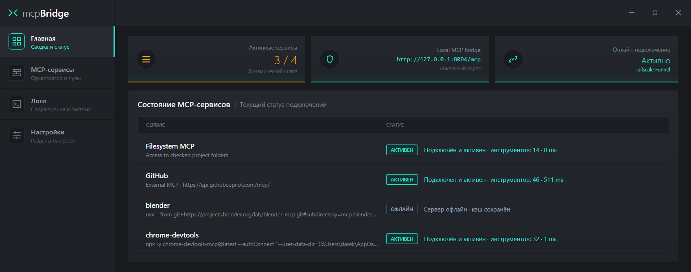
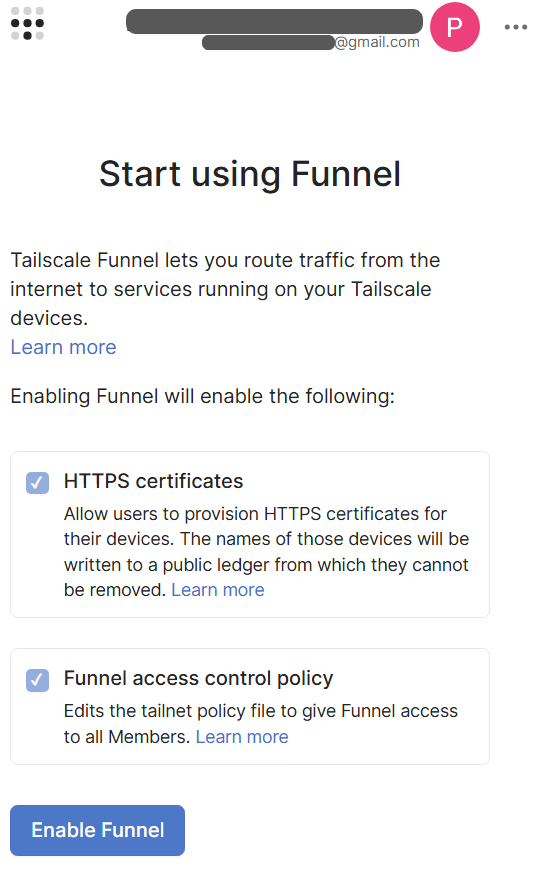
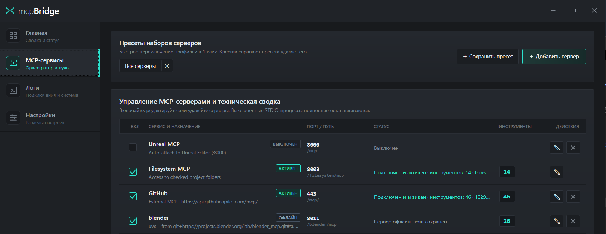

  <a href="docs/donate.md" title="Поддержать проект"> Поддержать</a> ·
  <a href="README.ru.md">Русский</a> · <a href="README.md">English</a>

  
  <h1>mcp<b>Bridge</b></h1>
  

    <b>Единый локальный хаб и менеджер MCP-серверов для Windows</b> 
    Подключите локальные MCP-серверы к браузерному ИИ или десктопному клиенту через один адрес.
  

  

    
  

  

## Зачем нужен MCP Bridge

Когда к AI-клиенту подключено несколько MCP-серверов, управлять ими и доступными инструментами может быть неудобно. MCP Bridge собирает локальные и удалённые серверы в одном приложении и предоставляет клиенту единый адрес подключения.

С помощью Bridge можно:

- подключать несколько MCP-серверов через один endpoint;
- включать и выключать серверы прямо во время чата;
- сохранять наборы серверов для разных задач;
- подключать локальные STDIO-серверы к совместимым браузерным AI-клиентам через Tailscale Funnel.

Для локальных десктопных клиентов внешний туннель не нужен. Tailscale Funnel — отдельная опция, если веб-клиенту нужен доступ к Bridge через интернет.

## Демо

<video src="https://github.com/user-attachments/assets/6b1b49db-0a66-40c0-ac24-ed31efa85cad" width="900" controls muted playsinline>Ваш браузер не поддерживает встроенное видео.</video>

В демо показано, как отключать неиспользуемые MCP-серверы во время активного диалога.

## Быстрый старт

1. Скачайте установщик со [страницы последнего релиза](https://github.com/Darek3399/MCP-Bridge/releases/latest).
2. Установите и запустите MCP Bridge.
3. Откройте вкладку **MCP Services** и добавьте MCP-сервер. Можно вставить конфигурацию из документации сервера.
4. Нажмите **Verify & Add**. Если сервер зависит от закрытого приложения, используйте **Save Without Check**.
5. В настройках MCP-клиента добавьте подключение **Streamable HTTP** и укажите локальный адрес:

   `http://127.0.0.1:8004/mcp`

  

### Удалённый доступ через Tailscale Funnel

При первой настройке нужно авторизовать устройство в Tailscale и разрешить Funnel. После этого Bridge использует стабильное имя устройства и адрес Funnel: обычно не нужно заново входить в аккаунт или получать новый URL при каждом запуске. Адрес остаётся доступен, пока устройство авторизовано, работает и Funnel включён.

В отличие от многих временных туннелей, такой адрес не требуется получать заново при каждом запуске. У некоторых альтернатив постоянный адрес может быть доступен только на платном тарифе; условия сервисов различаются.

> Публичный URL может быть доступен из интернета. Не публикуйте его и включайте Funnel только тогда, когда вам нужен удалённый доступ.

  

## Возможности

### Переключение серверов во время чата

Включайте и выключайте MCP-серверы прямо во время активного диалога, не переподключая клиент вручную.

  

### Пресеты для разных задач

Сохраните комбинацию серверов как пресет и переключайтесь между наборами для разных сценариев — например, разработки или работы с файлами.

### Локальные STDIO-серверы

Bridge объединяет локальные консольные MCP-серверы, запускаемые через `npx`, `uvx`, `python` и другие инструменты, с подключением к общему шлюзу.

### Ограничение доступа к папкам

Для встроенного Filesystem MCP можно выбрать папки, доступные серверу. Выдавайте доступ только к каталогам, которые действительно нужны для работы.

## Как это устроено

  

1. AI-клиент подключается к endpoint MCP Bridge.
2. Bridge направляет запросы к включённым MCP-серверам.
3. Локальные серверы могут использовать STDIO, удалённые — HTTP.
4. Удалённый доступ для веб-клиента при необходимости включается отдельно через Tailscale Funnel.

Bridge предоставляет два meta-tools — `all_tools` и `call_tool` — для обнаружения и вызова инструментов подключённых серверов. Это позволяет не передавать клиенту описания всех инструментов сразу; результат зависит от клиента и модели.

## Безопасность и ограничения

- **Сторонние MCP-серверы** запускаются на вашем компьютере от имени вашего пользователя. Добавляйте только те команды и серверы, которым доверяете.
- **Filesystem MCP** может читать, изменять и удалять файлы в разрешённых папках. Не выдавайте доступ ко всему диску без необходимости.
- **Tailscale Funnel** открывает публичный URL. Не размещайте его в открытом доступе и выключайте Funnel, когда он не нужен.
- **Секреты серверов** — переменные окружения и заголовки авторизации — хранятся локально. Согласно текущей документации проекта, они сохраняются в открытом виде; учитывайте это при работе с ключами и токенами.

Подробнее: [SECURITY.md](SECURITY.md).

## Системные требования

- Windows 10 x64 (1903+) или Windows 11 x64.
- .NET Framework 4.8.
- Установщик для Windows x64 доступен на [странице релизов](https://github.com/Darek3399/MCP-Bridge/releases/latest).

## Технические сведения

- **Платформа:** Windows.
- **Язык интерфейса:** русский и английский.
- **MCP-транспорты:** STDIO и HTTP.
- **Локальный endpoint:** `http://127.0.0.1:8004/mcp`.
- **Meta-tools:** `all_tools` и `call_tool`.
- **Опциональный внешний доступ:** Tailscale Funnel.
- **Управление дочерними процессами:** Windows Job Objects.

## Участие в проекте

Нашли ошибку или хотите предложить улучшение?

- [Создать issue](https://github.com/Darek3399/MCP-Bridge/issues).
- [Посмотреть исходный код](https://github.com/Darek3399/MCP-Bridge).

## Лицензия

Условия использования проекта описаны в файле [LICENSE](LICENSE).

## Поддержать проект

Если MCP Bridge оказался вам полезен, можно поддержать разработку:

  

---

  <a href="README.md">English</a> ·
  <a href="SECURITY.md">Безопасность</a> ·
  <a href="THIRD_PARTY_NOTICES.md">Сторонние компоненты</a> ·
  <a href="docs/donate.md">Поддержать проект</a>

