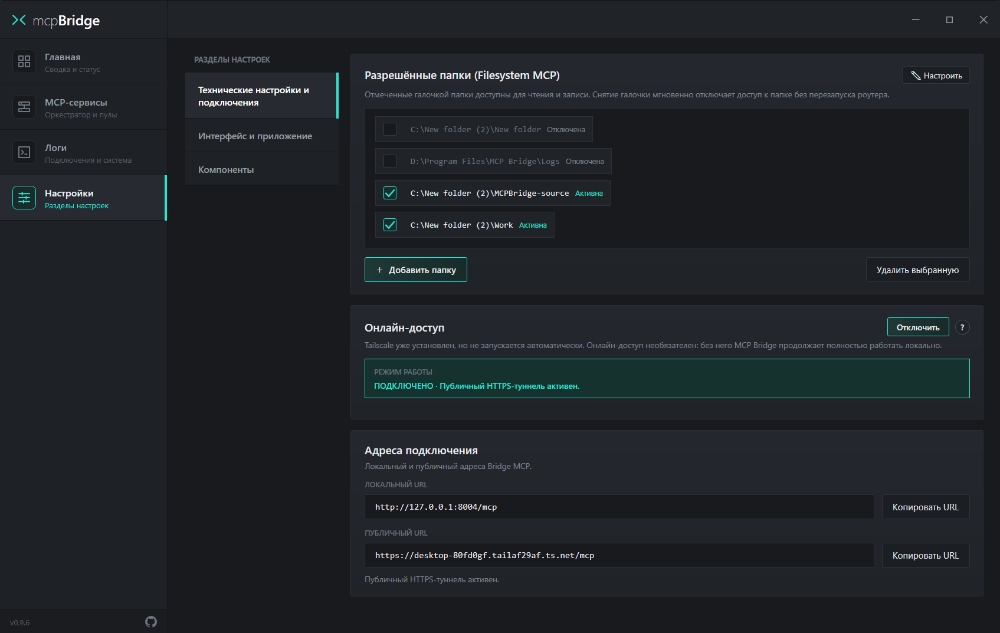
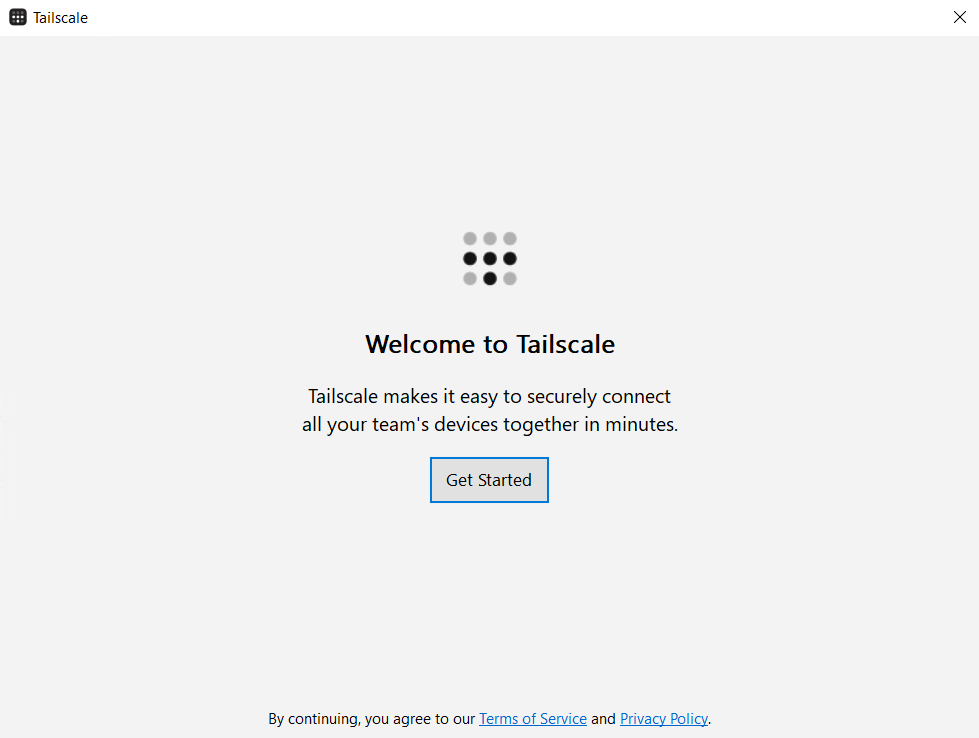
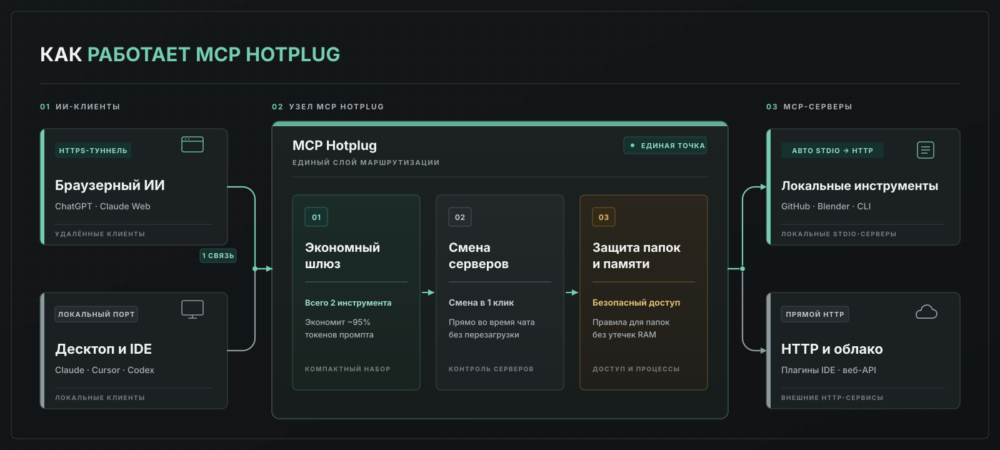

  &nbsp;
  &nbsp;
  

  
  <h1>mcp<b>Bridge</b></h1>

  <h3>Один адрес для всех MCP-серверов. Переключайте инструменты, не перезапуская чат.</h3>

  

    MCP Bridge объединяет локальные и удалённые MCP-серверы в одном приложении для Windows. 
    Подключите AI-клиент один раз, а затем включайте только нужные серверы.
  

  

    
    &nbsp;
    
  

  
Windows 10/11 · Для локальных десктопных клиентов публичный туннель не нужен

  

## Что решает MCP Bridge

- **Один адрес подключения:** объедините несколько локальных и удалённых MCP-серверов.
- **Переключение на лету:** включайте и выключайте серверы во время работы.
- **Пресеты для задач:** сохраняйте наборы серверов и быстро переключайтесь между ними.
- **Локальные серверы в веб-ИИ:** при необходимости подключайте локальные STDIO-серверы через Tailscale Funnel.

> **Для локальных десктопных клиентов туннель не нужен.** Tailscale Funnel — дополнительная настройка для совместимых веб-клиентов, которым нужен удалённый доступ.

## Быстрый старт

1. Скачайте установщик со [страницы последнего релиза](https://github.com/Darek3399/MCP-Bridge/releases/latest).
2. Установите и запустите MCP Bridge.
3. Откройте вкладку **MCP Services** и добавьте MCP-сервер. Можно вставить конфигурацию из документации сервера.
4. Нажмите **Verify & Add**. Если сервер зависит от закрытого приложения, выберите **Save Without Check**.
5. В настройках MCP-клиента добавьте подключение **Streamable HTTP** и укажите локальный адрес:

   `http://127.0.0.1:8004/mcp`

  

## Удалённый доступ через Tailscale Funnel

При первоначальной настройке авторизуйте устройство в Tailscale и включите Funnel. После этого используется стабильное имя устройства и адрес Funnel: обычно не нужно снова входить в аккаунт или получать новый URL при каждом запуске Bridge. Адрес доступен, пока устройство авторизовано и работает, а Funnel включён.

В отличие от временных туннелей, этот адрес не нужно получать заново при каждом запуске. Условия других сервисов туннелирования отличаются; постоянный адрес у некоторых из них может быть доступен только на платном тарифе.

<table>
  <tr>
    <td width="33%" align="center" valign="top">
      
       <b>1. Запустите Tailscale</b>
    </td>
    <td width="33%" align="center" valign="top">
      
       <b>2. Авторизуйте устройство</b>
    </td>
    <td width="33%" align="center" valign="top">
      
       <b>3. Включите Funnel</b>
    </td>
  </tr>
</table>

> **Безопасность:** публичный URL может быть доступен из интернета. Не публикуйте его и включайте Funnel только тогда, когда нужен удалённый доступ.

## Возможности

### Переключайте серверы прямо во время чата

Включайте и выключайте MCP-серверы во время активного диалога, не переподключая клиент вручную.

  

### Используйте пресеты для разных задач

Сохраните комбинацию серверов как пресет и переключайтесь между наборами для разных сценариев — например, разработки или работы с файлами.

### Подключайте локальные STDIO-серверы

Bridge объединяет локальные консольные MCP-серверы, запускаемые через `npx`, `uvx`, `python` и другие инструменты, с подключением к общему шлюзу.

### Ограничивайте доступ к папкам

Для встроенного Filesystem MCP выберите папки, доступные серверу. Выдавайте доступ только к тем каталогам, которые действительно нужны для работы.

## Как это устроено

  

1. AI-клиент подключается к endpoint MCP Bridge.
2. Bridge направляет запросы к включённым MCP-серверам.
3. Локальные серверы могут использовать STDIO, удалённые — HTTP.
4. Удалённый доступ для веб-клиента при необходимости включается отдельно через Tailscale Funnel.

Bridge предоставляет два meta-tools — `all_tools` и `call_tool` — для обнаружения и вызова инструментов подключённых серверов. Это позволяет не передавать клиенту описания всех инструментов сразу. Фактический эффект зависит от клиента и модели.

## Безопасность и ограничения

- **Сторонние MCP-серверы** запускаются на вашем компьютере от имени вашего пользователя. Добавляйте только те команды и серверы, которым доверяете.
- **Filesystem MCP** может читать, изменять и удалять файлы в разрешённых папках. Не выдавайте доступ ко всему диску без необходимости.
- **Tailscale Funnel** открывает публичный URL. Не размещайте его в открытом доступе и выключайте Funnel, когда он не нужен.
- **Секреты серверов** — переменные окружения и заголовки авторизации — хранятся локально. Согласно текущей документации проекта, они сохраняются в открытом виде; учитывайте это при работе с ключами и токенами.

Подробнее: [SECURITY.md](SECURITY.md).

## Системные требования

- Windows 10 x64 (1903+) или Windows 11.
- .NET Framework 4.8.
- Установщик для Windows x64 доступен на [странице релизов](https://github.com/Darek3399/MCP-Bridge/releases/latest).

## Технические сведения

- **Платформа:** Windows.
- **Язык интерфейса:** русский и английский.
- **MCP-транспорты:** STDIO и HTTP.
- **Локальный endpoint:** `http://127.0.0.1:8004/mcp`.
- **Meta-tools:** `all_tools` и `call_tool`.
- **Опциональный внешний доступ:** Tailscale Funnel.
- **Управление дочерними процессами:** Windows Job Objects.

## Участие в проекте

Нашли ошибку или хотите предложить улучшение?

- [Создать issue](https://github.com/Darek3399/MCP-Bridge/issues).
- [Посмотреть исходный код](https://github.com/Darek3399/MCP-Bridge).

## Лицензия

Условия использования проекта описаны в файле [LICENSE](LICENSE).

## Поддержать проект

Если MCP Bridge оказался вам полезен, можно поддержать разработку:

  

---

  <a href="README.md">English</a> ·
  <a href="SECURITY.md">Безопасность</a> ·
  <a href="THIRD_PARTY_NOTICES.md">Сторонние компоненты</a> ·
  <a href="docs/donate.md">Поддержать проект</a>

