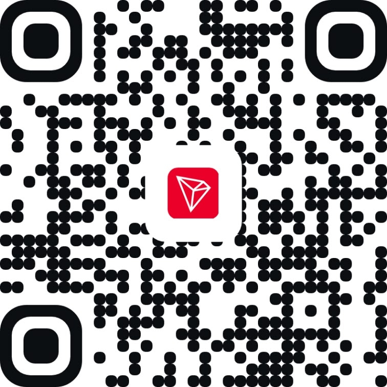
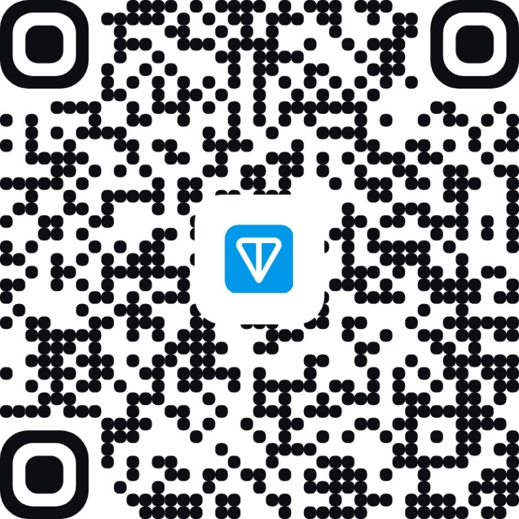

<h1>Support the Developer · Поддержать разработчика</h1>

  If <b>MCP Bridge</b> saves you time and tokens, you can support its development via crypto (worldwide) or card tips (Russia): 
  Если <b>MCP Bridge</b> экономит вам время и токены, поддержать разработку можно криптой или картой:

---

<h2 align="center">USDT · TRC-20 (Tron Network)</h2>

  

  <code>TAXBjaZVVbumk9psRkG6Nbs5KMAGyyzAxe</code>

---

<h2 align="center">TON (The Open Network)</h2>

  

  <code>UQDcKvh4rOSSjXQm5OZfsjIB6ZblR9v1sAQCFNeH_MfO0ewZ</code>

